# DrishX — Operations & Role Capability Specification

**Document type:** Reverse-engineered technical specification
**Status:** Describes the system **as it exists in code today** — not a roadmap, not a design proposal
**Generated:** 18 August 2026

---

## 1. Purpose & Scope

### 1.1 Purpose

This document is a single, authoritative description of what the DrishX platform actually does today, derived entirely by reading source code across the three repositories. It exists so that any engineer, tester, or product owner can answer three questions without re-reading the codebase:

1. **Who is allowed to do what?** (roles, guards, validation)
2. **How does work actually flow?** (order lifecycle, procurement, returns)
3. **Where does the code disagree with itself?** (gaps between backend guards and frontend UI, stubs, dead endpoints)

### 1.2 Scope — the three repositories

| Repo | Local path | Technology | What it is |
| --- | --- | --- | --- |
| **Admin + Backend** | `C:\app-project\drishx\drishx-admin-backend` | Next.js App Router, Prisma, PostgreSQL | The **single source of truth**. Hosts the entire REST API (`app/api/**/route.ts`) *and* the Admin web panel in one deployment. |
| **Web App** | `C:\app-project\drishx\drishx-web-app` | Next.js 16 App Router | Customer portal + Employee operations portal. Holds **no database**; proxies every call to the backend. |
| **Mobile App** | `C:\app-project\drishx\drishx-mobile-app` | Expo / React Native, expo-router | Customer app + Staff app in one binary, switched by role. Calls the backend **directly**. |

### 1.3 Important correction to earlier assumptions

Earlier planning documents assumed the backend was an **Express + Prisma** service separate from the admin UI, and that a **Super Admin** role existed. Neither is true in code:

- The backend is **not Express**. It is a Next.js App Router application; every endpoint is a `route.ts` file exporting `GET` / `POST` / `PUT` / `PATCH` / `DELETE`.
- There are exactly **three roles** in the Prisma enum and nothing else:

```prisma
enum UserRole {
  ADMIN
  EMPLOYEE
  CUSTOMER
}
```

- There is **no RBAC table**, no permission rows, no role-assignment model. Authorisation is a hand-written `if (session.role !== "...")` check inside each route handler.
- There is **no `middleware.ts`** in any of the three repos. Not in the backend, not in the web app, and no equivalent global guard in Expo.

### 1.4 Out of scope

Payment gateway integration, discounts, credit limits, loyalty/wallet, attendance, payroll, audit logs, and AI features are **not implemented**. They appear only as non-clickable sidebar labels or "Coming soon" pages, and are catalogued in [Section 11](#11-not-yet-implemented--todo).

---

## 2. Core Operating Model

DrishX is a **B2B wholesale optical-lens distribution platform**. Optical shops register themselves, submit GST and business details, and wait for an admin to approve the account before they can transact — an unapproved customer is redirected to `/pending-approval` on every login and cannot place an order because `POST /api/orders` re-checks `isApproved` server-side. Once approved, a shop browses live SKU inventory across six lens families (Single Vision, Kryptok, Progressive, OriVision, Magnus, Bifocal) and places orders through five distinct entry points: a retail catalog cart, a wholesale power-matrix grid, a custom RX prescription form, a multi-step colour-tint wizard, and (mobile only) a photographed prescription upload. Every checkout writes an `Order` row per line, computes how much of the requested quantity can actually be reserved from on-hand stock, and sets the order to `PENDING` when fully coverable or `AWAITING_PROCUREMENT` when it is not. The order is then auto-assigned to the **active employee with the fewest open checkout batches** via `resolveOrderAssigneeId()`, a CREDIT `Transaction` plus a matching `LedgerEntry` are recorded, and an `Invoice` is issued in `UNPAID` state. From that point the employee owns the order: they progress it `PENDING → PICKING → PACKED → DISPATCHED → COMPLETED` from either the web `/employee/orders` screens or the mobile Orders tab, and physical stock is only decremented at the moment the order reaches `PACKED` or `COMPLETED` (`fulfillOrderPick()`), never at checkout. When stock genuinely cannot be sourced, staff mark the power unavailable, the system generates ranked alternate-power suggestions, and the **customer alone** decides whether to accept a substitute — accepting supersedes the old power version and re-reserves stock against the new one. Admins sit above all of this in a dedicated panel: they approve or reject customer accounts, create employees, assign tasks, own the entire returns decision (credit note vs replacement order vs rejection, with a stock-disposition choice), manage the lens catalog, record manual expenses, and are the only role that can force-cancel or hard-delete an order.

---

## 3. Role Hierarchy

There are three roles and **no Super Admin**. The hierarchy is not implemented as an inheritance tree in code — it is an emergent property of the per-route `if` checks. Notably, `ADMIN` is a strict superset of `EMPLOYEE` for operations, and shares the *same* staff UI on web and mobile.

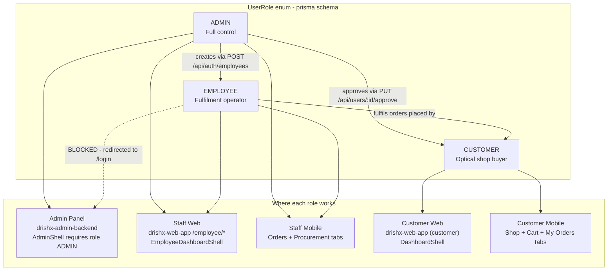

### 3.1 Key structural facts about the hierarchy

- **`ADMIN` and `EMPLOYEE` share one staff UI.** In the web app there is no `AdminShell`; both roles land in `EmployeeDashboardShell` and see identical navigation. Admin-only extras are gated *inside* components, e.g. the Manual Expenses tab checks `user?.role === "ADMIN"` in `components/employee/employee-procurement-screen.tsx` and in the mobile `app/(tabs)/purchase-stock.tsx`.
- **`EMPLOYEE` cannot enter the Admin Panel.** `components/admin-shell.tsx` in the backend repo reads the token from `localStorage` and redirects to `/login` unless `user.role === "ADMIN"`; `app/login/page.tsx` additionally clears the session of any non-admin who signs in there.
- **Employees are data-scoped, admins are not.** `GET /api/orders` builds its `where` clause by role: customers see `{ userId: session.userId }`, employees see `{ assignedToId: session.userId }`, and admins see everything with optional `employeeId` / `userId` / `batchId` filters.
- **Account creation paths differ per role.** Customers self-register (`POST /api/auth/signup`, public). Employees can only be created by an admin (`POST /api/auth/employees`). The first admin is bootstrapped out-of-band via `POST /api/auth/admin` guarded by an `x-admin-secret` header matching `ADMIN_CREATION_SECRET` — this is the only non-JWT privileged endpoint.

---

## 4. Role Capabilities

### 4.1 Customer

A `CUSTOMER` is an optical shop. The role is created by self-signup and is inert until an admin approves it.

#### 4.1.1 Responsibilities

| Capability | Where it lives | Endpoint |
| --- | --- | --- |
| Self-register an account | web `/signup`, mobile `app/signup.tsx` | `POST /api/auth/signup` |
| Submit GST + business details | web `/gst-details`, mobile `app/gst-details.tsx` | `POST /api/auth/gst` |
| Wait for approval (polls every 5s) | web `/pending-approval`, mobile `app/pending-approval.tsx` | `GET /api/auth/me` |
| Browse retail lens catalog | web `/shop`, `/shop/products`, `/shop/search`; mobile `app/(tabs)/shop/*` | `GET /api/lenses`, `/lenses/items`, `/lenses/coatings`, `/lenses/related`, `/lenses/siblings` |
| View a lens and pick prescription powers | web `/shop/products/[id]`, mobile `app/(tabs)/shop/lens-product.tsx` | `GET /api/lenses/{type}/{id}` |
| Manage a server-side cart | web `/basket` (alias `/cart`), mobile `app/(tabs)/cart.tsx` | `GET`/`POST`/`DELETE /api/cart`, `POST /api/cart/bulk` |
| Retail checkout | `components/cart/cart-screen.tsx` | `POST /api/orders` |
| Build a wholesale power matrix and check out | web `/wholesale/order`, mobile `app/wholesale/product-order.tsx` | `POST /api/cart/wholesale` then `POST /api/orders/wholesale-checkout` |
| Place a custom RX order (with optional prescription photo) | web `/rx`, mobile `app/rx/index.tsx` | `POST /api/orders/rx`, `POST /api/orders/rx/prescription` |
| Place a colour-lens order (predefined / reference photo / custom mix) | web `/color/*` wizard, mobile `app/color/*` | `POST /api/color-references`, `POST /api/orders/color-lens` |
| Upload a photographed prescription as an order | **mobile only** — `app/(tabs)/shop/index.tsx` | `POST /api/orders/photo` |
| Browse the white/clear catalog | web `/white/*`, mobile `app/white/*` | client-side `lib/white-catalog.ts` (no backend) |
| Track own orders | web `/my-orders`, `/my-orders/[id]`; mobile `app/(tabs)/my-orders.tsx` | `GET /api/orders`, `GET /api/orders/:id` |
| Accept / reject an alternate power suggestion | `components/orders/alternate-power-panel.tsx` (`mode="customer"`) | `POST /api/orders/:id/alternate-suggestions/:sid/accept`, `.../reject`, `.../reject-all` |
| View power-version history of an order | order detail screens | `GET /api/orders/:id/power-versions` |
| Raise a return or replacement request with photos | web `components/orders/return-request-panel.tsx`, mobile `app/return-request.tsx` | `POST /api/returns`, `POST /api/returns/:id/images` |
| Track return requests | web `/returns`, `/returns/[id]`; mobile `app/returns.tsx` | `GET /api/returns`, `GET /api/returns/:id` |
| View invoices | web `/profile/invoices`, mobile `app/invoices.tsx` | `GET /api/invoices`, `GET /api/invoices/:id` |
| View own company/GST profile | web `/profile/company`, mobile `app/company-profile.tsx` | from cached auth user |
| Read notifications | web `/notifications`, mobile `app/notifications.tsx` | `GET`/`PATCH /api/notifications` |

#### 4.1.2 Restrictions

| Restriction | Enforced by |
| --- | --- |
| Cannot place any order until approved | `POST /api/orders`, `/orders/rx`, `/orders/color-lens`, `/orders/photo` all re-check approval server-side; `DashboardShell` renders children only when `isCustomerApproved(user)` |
| Cannot reach staff or admin screens | `EmployeeDashboardShell` redirects non-staff to `/`; `AdminShell` redirects non-admin to `/login` |
| Can only ever see own data | `GET /api/orders`, `/api/returns`, `/api/invoices` all narrow the query to `session.userId` for `CUSTOMER` |
| **Status changes limited to cancellation only** | `PUT /api/orders/:id` — "Customers can only cancel orders." |
| Cancellation only from `PENDING` or `AWAITING_PROCUREMENT` | same handler validates the current status before allowing `CANCELLED` |
| Cannot decide their own return outcome | `POST /api/returns/:id/decision` is `ADMIN` only |
| Cannot see or set prices, stock, or assignment | no customer-facing endpoint accepts `unitPrice`, `quantity` on-hand, or `assignedToId` |
| Cannot create another user of any kind | `POST /api/auth/employees` is `ADMIN` only |

> **Live gap:** the customer cancel capability is reachable by API but **not by UI**. `cancelOrder()` is defined at `lib/orders-api.ts` in the web app but is never imported or called by any component. The mobile app *does* wire it up in `app/(tabs)/my-orders.tsx`. See [Section 10](#10-gaps--inconsistencies-found).

---

### 4.2 Employee

An `EMPLOYEE` is a warehouse/fulfilment operator. Created only by an admin. Sees a workload-scoped slice of the system.

#### 4.2.1 Responsibilities

| Capability | Where it lives | Endpoint |
| --- | --- | --- |
| Staff operations dashboard | web `/employee/home`, mobile `app/(tabs)/index.tsx` (staff branch) | aggregate reads |
| Work the assigned-orders queue | web `/employee/orders`, mobile `app/(tabs)/orders.tsx` | `GET /api/orders` (auto-scoped to `assignedToId`) |
| Work the RX-only queue | web `/employee/orders/rx`, mobile `app/rx-orders.tsx` | `GET /api/orders` filtered client-side |
| Open an order and progress its status | web `/employee/orders/[id]`, mobile `app/order-details.tsx` | `PUT /api/orders/:id` |
| Record picked quantity per line | mobile `components/employee-order-range-sheet.tsx`, web order detail | `PUT /api/orders/:id` with `pickedQuantity` |
| Edit quantity / price / notes on an editable order | web + mobile order detail | `PATCH /api/orders/:id` (only while `PENDING` or `AWAITING_PROCUREMENT`) |
| Place an order on behalf of a customer | web `/employee/orders/on-behalf/**`, mobile `app/employee-order-on-behalf.tsx` | `POST /api/orders`, `/orders/rx`, `/orders/color-lens`, `/orders/wholesale-checkout` with explicit `userId` |
| Mark an ordered power as not available | `components/orders/alternate-power-panel.tsx` (`mode="staff"`) | `POST /api/orders/:id/procurement/not-available` |
| Work the procurement queue | web `/employee/procurement`, mobile `app/(tabs)/purchase-stock.tsx` | `GET /api/orders?status=AWAITING_PROCUREMENT`, `GET /api/expenses/procurement` |
| Record stock intake (single or batch), optionally against an order | same screens | `POST /api/expenses/procurement` |
| Browse inventory and stock levels | web `/employee/inventory`, mobile `app/inventory.tsx` | `GET /api/lenses` |
| Complete assigned tasks | web `/employee/tasks`, mobile `app/(tabs)/my-tasks.tsx` | `GET /api/tasks`, `PATCH /api/tasks/:id` |
| Process assigned returns — request more information, add remarks | web `/employee/returns/[id]`, mobile `app/return-details.tsx` | `PATCH /api/returns/:id` with `action: "more-info"` |
| Upload evidence photos on an assigned return | mobile/web return detail | `POST /api/returns/:id/images` |
| Look up customers and colleagues | on-behalf screens | `GET /api/users/customers`, `GET /api/users/employees` |
| Record income entries | staff finance screens | `GET`/`POST`/`PUT`/`DELETE /api/income` |
| Read notifications | web `/employee/notifications`, mobile `app/notifications.tsx` | `GET`/`PATCH /api/notifications` |

#### 4.2.2 Restrictions

| Restriction | Enforced by |
| --- | --- |
| **Cannot log into the Admin Panel** | `components/admin-shell.tsx` requires `role === "ADMIN"`; `app/login/page.tsx` rejects and clears non-admin sessions |
| Sees only orders assigned to them | `GET /api/orders` forces `{ assignedToId: session.userId }` for `EMPLOYEE` |
| Cannot update an order assigned to someone else | `PUT`/`PATCH /api/orders/:id` return 403 "Not your assigned order" |
| **Cannot reassign an order** | `assignedToId` in the `PUT` body is honoured only when `session.role === "ADMIN"` |
| Cannot force-cancel | `force: true` is honoured only for `ADMIN` |
| Cannot hard-delete an order | `DELETE /api/orders/:id` is `ADMIN` only |
| **Cannot decide a return** | `POST /api/returns/:id/decision` is `ADMIN` only |
| Cannot escalate, reject, close, or assign a return | `PATCH /api/returns/:id` — "Employees cannot escalate. Returns are reviewed by admin first." |
| Cannot approve or reject a customer account | `PUT /api/users/:id/approve` and `GET /api/users/pending` are `ADMIN` only |
| Cannot create employees | `POST /api/auth/employees` is `ADMIN` only |
| **Cannot create or delete tasks — only complete them** | `POST /api/tasks` and `DELETE /api/tasks/:id` are `ADMIN` only |
| Cannot record manual expenses | all of `/api/expenses/manual` is `ADMIN` only; the tab is hidden in UI |
| Cannot create lens SKUs | `POST /api/lenses/{single-vision,kryptok,progressive}` is `ADMIN` only |
| Cannot manage catalog lines or coating filters | all of `/api/admin/**` is `ADMIN` only |
| Cannot change alternate-power settings | `PUT /api/settings/alternate-power` is `ADMIN` only (read is staff-wide) |
| Cannot fulfil procurement for an unassigned order | `POST /api/expenses/procurement` re-checks assignment when `orderId` is supplied |

---

### 4.3 Admin

`ADMIN` is the operational owner. It has every employee capability plus exclusive control over approvals, catalog, people, returns decisions, and destructive actions.

#### 4.3.1 Responsibilities

Admins retain **every capability listed in Section 4.2** (they pass all `role === "ADMIN" || role === "EMPLOYEE"` checks), and additionally:

| Capability | Where it lives | Endpoint |
| --- | --- | --- |
| Log into the Admin Panel | `components/admin-shell.tsx`, `app/login/page.tsx` | `POST /api/auth/login` |
| See **all** orders, unscoped, with filters | `/orders`, `/orders/[id]` | `GET /api/orders?employeeId=&userId=&batchId=` |
| Manage the RX lab queue | `/orders/rx-lab` | `GET /api/orders` |
| Manage dispatch | `/orders/dispatch` | `PUT /api/orders/:id` |
| Manage procurement centrally | `/orders/procurement` | `GET`/`POST /api/expenses/procurement` |
| **Reassign an order to another employee** | order detail | `PUT /api/orders/:id` with `assignedToId` |
| **Force-cancel an order from any status except `COMPLETED`** | order detail | `PUT /api/orders/:id` with `force: true` |
| **Hard-delete an order and its dependents** | order detail | `DELETE /api/orders/:id` |
| **Approve or reject a customer account** | `/clients`, `/clients/[id]` | `PUT /api/users/:id/approve` with `action` + `rejectionReason` |
| Review the pending-approval queue | `/clients` | `GET /api/users/pending` |
| **Create employees** | `/employees` | `POST /api/auth/employees` |
| Inspect employee workload and performance data | `/employees/[id]` | `GET /api/users/employees/:id`, `GET /api/orders?employeeId=` |
| **Create and delete tasks** | `/employees/[id]` | `POST /api/tasks`, `DELETE /api/tasks/:id` |
| **Decide every return** — credit note, replacement order, or rejection, with stock disposition and employee assignment | `/returns/[id]` | `POST /api/returns/:id/decision` |
| Escalate, reject, close, or reassign a return | `/returns/[id]` | `PATCH /api/returns/:id` with `action: escalate\|reject\|close\|assign` |
| Create a return on a customer's behalf | `/returns/new` | `POST /api/returns` |
| **Create lens SKUs** | inventory screens | `POST /api/lenses/{single-vision,kryptok,progressive}` |
| View full stock overview | `/inventory/stock-overview` | `GET /api/lenses` |
| **Manage catalog product lines** | admin catalog screens | `GET`/`POST`/`PUT`/`DELETE /api/admin/catalog-lines` |
| **Manage coating filter labels, sync and merge them** | admin catalog screens | `/api/admin/coating-filters`, `.../sync`, `.../merge` |
| Review sales and invoices | `/finance/invoices` | `GET /api/invoices` |
| **Record, edit and delete manual expenses** | `/finance/expenses`, staff Manual tab | `GET`/`POST`/`PUT`/`DELETE /api/expenses/manual` |
| **Change alternate-power workflow settings** | `/settings` | `PUT /api/settings/alternate-power` |

#### 4.3.2 Restrictions

Admin is the ceiling of the permission model; the only genuine restrictions are workflow invariants rather than role checks.

| Restriction | Enforced by |
| --- | --- |
| Cannot un-cancel an order | `PUT /api/orders/:id` rejects any transition out of `CANCELLED` |
| Cannot cancel a `COMPLETED` order even with `force: true` | `canTransitionStatus()` — `if (options?.allowAdminForce && to === "CANCELLED" && from !== "COMPLETED")` |
| Cannot transition out of `COMPLETED` or `CANCELLED` at all | `getStaffStatusOptions()` returns `[]` for both |
| Cannot re-decide an already-decided return | `POST /api/returns/:id/decision` allows only `SUBMITTED`, `MORE_INFO_REQUIRED`, `ESCALATED_TO_ADMIN` |
| Cannot approve a return without assigning an active employee | same handler: "An employee must be assigned when approving a return." |
| Cannot approve a return without choosing a stock disposition | same handler, unless the decision is `REJECT` |
| Cannot reject a return without remarks | same handler: "Remarks are required to reject." |
| Cannot upload a photo order | `POST /api/orders/photo` is **`CUSTOMER` only** |
| Cannot accept or reject an alternate power on the customer's behalf | all three accept/reject endpoints require the session user to be the order owner |
| Cannot edit an order outside an editable status | `isEditableOrderStatus()` — `PENDING` or `AWAITING_PROCUREMENT` only |
| Cannot mark a power unavailable outside `AWAITING_PROCUREMENT` | `markPowerNotAvailable()` throws otherwise |
| Cannot mark a power unavailable on a wholesale order | `assertRetailOrder()` in `app/lib/alternate-power-workflow.ts` |

---

## 5. Permission Matrix

Legend — **Yes** = allowed unconditionally for that role; **No** = blocked by a guard or simply has no code path; **Cond.** = allowed subject to the stated condition; **Public** = no authentication required at all.

| # | Action / Feature | Enforcing endpoint | Customer | Employee | Admin |
| --- | --- | --- | --- | --- | --- |
| 1 | Self-register an account | `POST /api/auth/signup` | Public | No — admin-created | No — `x-admin-secret` bootstrap |
| 2 | Submit GST / business details | `POST /api/auth/gst` | **Public** — no JWT, accepts `userId` in body | Public | Public |
| 3 | Log in | `POST /api/auth/login` | Cond. — blocked if `approvalStatus = REJECTED` | Yes | Yes |
| 4 | Read own profile | `GET /api/auth/me` | Yes | Yes | Yes |
| 5 | Browse lens catalog / facets / siblings | `GET /api/lenses*` | **Public** | Public | Public |
| 6 | Read catalog images | `GET /api/catalog-images` | **Public** | Public | Public |
| 7 | Manage cart lines | `GET`/`POST`/`DELETE /api/cart`, `/cart/bulk` | Cond. — own cart only | Cond. — requires `?userId=` | Cond. — requires `?userId=` |
| 8 | Add wholesale batch to cart | `POST /api/cart/wholesale` | Cond. — own cart | Cond. — requires `userId` | Cond. — requires `userId` |
| 9 | Retail checkout | `POST /api/orders` | Cond. — must be approved | Cond. — must pass `userId` or `user{}` | Cond. — must pass `userId` or `user{}` |
| 10 | Wholesale checkout | `POST /api/orders/wholesale-checkout` | Cond. — own batches | Cond. — requires `userId` | Cond. — requires `userId` |
| 11 | Place RX order | `POST /api/orders/rx` | Cond. — must be approved | Cond. — requires `userId` | Cond. — requires `userId` |
| 12 | Upload RX prescription file | `POST /api/orders/rx/prescription` | Cond. — approved | Yes | Yes |
| 13 | Place colour-lens order | `POST /api/orders/color-lens` | Cond. — approved | Cond. — requires `userId` | Cond. — requires `userId` |
| 14 | Upload colour reference image | `POST /api/color-references` | Cond. — approved | Yes | Yes |
| 15 | **Upload photographed prescription order** | `POST /api/orders/photo` | Cond. — approved, **mobile UI only** | **No** | **No** |
| 16 | List orders | `GET /api/orders` | Cond. — own only | Cond. — assigned only | Yes — all + filters |
| 17 | Read one order | `GET /api/orders/:id` | Cond. — own | Cond. — assigned | Yes |
| 18 | **Cancel an order** | `PUT /api/orders/:id` | Cond. — `PENDING`/`AWAITING_PROCUREMENT`; **no web UI**, mobile UI exists | Cond. — via staff transition map, assigned orders | Yes |
| 19 | Advance fulfilment status | `PUT /api/orders/:id` | No | Cond. — assigned orders, per transition map | Yes |
| 20 | Set picked quantity | `PUT /api/orders/:id` | No | Cond. — assigned | Yes |
| 21 | Set courier / tracking number | `PUT /api/orders/:id` | No | Cond. — assigned | Yes |
| 22 | **Reassign order to another employee** | `PUT /api/orders/:id` `assignedToId` | No | **No** | Yes |
| 23 | **Force-cancel from any status** | `PUT /api/orders/:id` `force: true` | No | **No** | Cond. — not from `COMPLETED` |
| 24 | Edit order qty / price / notes | `PATCH /api/orders/:id` | No | Cond. — assigned + status editable | Cond. — status editable |
| 25 | **Hard-delete an order** | `DELETE /api/orders/:id` | No | **No** | Yes |
| 26 | Mark power not available | `POST /api/orders/:id/procurement/not-available` | No | Cond. — retail order in `AWAITING_PROCUREMENT` | Cond. — same |
| 27 | Read alternate suggestions | `GET /api/orders/:id/alternate-suggestions` | Cond. — own order | Cond. — accessible order | Yes |
| 28 | **Accept / reject alternate power** | `POST .../accept`, `.../reject`, `.../reject-all` | Cond. — order owner, suggestion `PENDING` | **No** | **No** |
| 29 | Read power-version history | `GET /api/orders/:id/power-versions` | Cond. — own | Cond. — accessible | Yes |
| 30 | Submit return / replacement request | `POST /api/returns` | Yes | Yes — on behalf | Yes — on behalf |
| 31 | List / read return requests | `GET /api/returns`, `/returns/:id` | Cond. — own | Cond. — assigned | Yes — all |
| 32 | Request more info on a return | `PATCH /api/returns/:id` `action=more-info` | No | Cond. — assigned | Yes |
| 33 | **Escalate / reject / close / assign a return** | `PATCH /api/returns/:id` | No | **No** | Yes |
| 34 | **Decide a return (credit / replacement / reject)** | `POST /api/returns/:id/decision` | No | **No** | Cond. — status decidable, employee + disposition required |
| 35 | Upload return evidence photo | `POST /api/returns/:id/images` | Cond. — own request | Cond. — assigned request | Yes |
| 36 | View invoices | `GET /api/invoices`, `/invoices/:id` | Cond. — own | Yes — all | Yes — all |
| 37 | **Pay an invoice** | — | **No — no payment endpoint exists.** Invoice flips to `PAID` only when its order reaches `COMPLETED` | No | No |
| 38 | List tasks | `GET /api/tasks` | No | Cond. — own tasks | Yes + `?employeeId=` |
| 39 | Complete / reopen a task | `PATCH /api/tasks/:id` | No | Cond. — own task | Yes |
| 40 | **Create a task** | `POST /api/tasks` | No | **No** | Yes |
| 41 | **Delete a task** | `DELETE /api/tasks/:id` | No | **No** | Yes |
| 42 | Read / mark notifications | `GET`/`PATCH /api/notifications` | Yes — own | Yes — own | Yes — own |
| 43 | Record stock intake / procurement expense | `GET`/`POST /api/expenses/procurement` | No | Cond. — assigned order if `orderId` given, order must be `AWAITING_PROCUREMENT` | Yes |
| 44 | **Manual expenses (CRUD)** | `/api/expenses/manual*` | No | **No** | Yes |
| 45 | Income records (CRUD) | `/api/income*` | No | Yes | Yes |
| 46 | List customers / employees | `GET /api/users/customers`, `/users/employees` | No | Yes | Yes |
| 47 | **Pending-approval queue** | `GET /api/users/pending` | No | **No** | Yes |
| 48 | **Approve / reject a customer** | `PUT /api/users/:id/approve` | No | **No** | Yes |
| 49 | **Create an employee** | `POST /api/auth/employees` | No | **No** | Yes |
| 50 | **Create a lens SKU** | `POST /api/lenses/{type}` | No | **No** | Yes |
| 51 | **Edit / delete a lens SKU** | `PUT`/`DELETE /api/lenses/{type}/:id` | **Public — unauthenticated** | Public | Public |
| 52 | Catalog product lines (CRUD) | `/api/admin/catalog-lines*` | No | **No** | Yes |
| 53 | Coating filters (CRUD, sync, merge) | `/api/admin/coating-filters*` | No | **No** | Yes |
| 54 | Read alternate-power settings | `GET /api/settings/alternate-power` | No | Yes | Yes |
| 55 | **Write alternate-power settings** | `PUT /api/settings/alternate-power` | No | **No** | Yes |
| 56 | **Admin Panel access** | `components/admin-shell.tsx` | No | **No — redirected to `/login`** | Yes |
| 57 | Staff web portal `/employee/*` | `EmployeeDashboardShell` | No | Yes | Yes |
| 58 | Customer web portal | `DashboardShell` | Cond. — approved + GST | No — redirected to `/employee/home` | No — redirected |
| 59 | Mobile staff tabs (Orders, Procurement) | `app/(tabs)/_layout.tsx` `isStaff` | Hidden — but **reachable by deep link** | Yes | Yes |
| 60 | Release expired cart reservations | `GET /api/cron/release-cart-reservations` | Cond. — `CRON_SECRET`; **open to all if the env var is unset** | Same | Same |

---

## 6. Feature Inventory by Repo

Status legend — **Working**: complete UI wired to a live endpoint. **Partial**: functional but with a missing surface, a hard-coded data source, or a missing guard. **Stubbed**: label or placeholder page with no implementation.

### 6.1 `drishx-admin-backend` — API + Admin Panel

Roughly 64 route files exporting ~95 handlers, plus 21 admin pages. Admin pages are **not** in a `(admin)` route group; they sit directly under `app/` and are wrapped in `AdminShell`.

| Feature | Screen or Endpoint | Role(s) | Status |
| --- | --- | --- | --- |
| Login (admin-gated) | `/login` | Admin only | Working |
| Admin dashboard | `/` | Admin | **Stubbed — "Coming soon"** |
| Orders list | `/orders` | Admin | Working |
| Order detail, status, reassign, force-cancel, delete | `/orders/[id]` | Admin | Working |
| RX lab queue | `/orders/rx-lab` | Admin | Working |
| Dispatch management | `/orders/dispatch` | Admin | Working |
| Procurement console | `/orders/procurement` | Admin | Working |
| Returns queue | `/returns` | Admin | Working |
| Return detail + decision | `/returns/[id]` | Admin | Working |
| Create return on behalf | `/returns/new` | Admin | Working |
| Stock overview | `/inventory/stock-overview` | Admin | Working |
| Power-wise stock | `/inventory/power-wise-stock` | Admin | **Stubbed — "Coming soon"** |
| Products & catalog | `/inventory/products-catalog` | Admin | **Stubbed — "Coming soon"** |
| Clients list / detail, approve & reject | `/clients`, `/clients/[id]` | Admin | Working |
| Employees list / detail, create, task assign | `/employees`, `/employees/[id]` | Admin | Working |
| Sales & invoices | `/finance/invoices` | Admin | Working |
| Expenses (manual + procurement) | `/finance/expenses` | Admin | Working |
| Settings (alternate-power workflow) | `/settings` | Admin | Working |
| Auth API — login, signup, me | `/api/auth/login`, `/signup`, `/me` | All / public | Working |
| Auth API — admin bootstrap | `POST /api/auth/admin` | `x-admin-secret` | Working |
| Auth API — employee creation | `POST /api/auth/employees` | Admin | Working |
| Auth API — GST submission | `POST /api/auth/gst` | **Unauthenticated** | **Partial — missing guard** |
| Orders API — list, create, read, update, patch, delete | `/api/orders`, `/api/orders/[id]` | Role-scoped | Working |
| Orders API — photo order | `POST /api/orders/photo` | Customer only | Working |
| Orders API — RX, colour, wholesale checkout | `/api/orders/rx`, `/color-lens`, `/wholesale-checkout` | Customer + staff-on-behalf | Working |
| Alternate-power API — suggest, accept, reject, versions | `/api/orders/[id]/alternate-suggestions/**`, `/power-versions` | Customer decides, staff triggers | Working |
| Procurement API — mark not available | `POST /api/orders/[id]/procurement/not-available` | Admin, Employee | Working |
| Returns API — list, submit, patch, decide, images | `/api/returns**` | Role-scoped | Working |
| Lens catalog reads | `/api/lenses`, `/items`, `/coatings`, `/siblings`, `/related` | **Unauthenticated** | **Partial — public inventory data** |
| Lens create | `POST /api/lenses/{type}` | Admin | Working |
| Lens update / delete | `PUT`/`DELETE /api/lenses/{type}/[id]` | **Unauthenticated** | **Partial — missing guard** |
| Cart API | `/api/cart`, `/cart/bulk`, `/cart/wholesale` | Customer, staff-on-behalf | Working |
| Users API — customers, employees, pending, approve | `/api/users/**` | Admin, Employee | Working |
| Invoices API | `/api/invoices`, `/api/invoices/[id]` | Role-scoped | **Partial — non-customer roles unscoped** |
| Tasks API | `/api/tasks`, `/api/tasks/[id]` | Admin creates, Employee completes | Working |
| Notifications API | `/api/notifications` | All authenticated | Working |
| Expenses API — procurement | `/api/expenses/procurement**` | Admin, Employee | Working |
| Expenses API — manual | `/api/expenses/manual**` | Admin | Working |
| Income API | `/api/income**` | Admin, Employee | Working |
| Settings API | `/api/settings/alternate-power` | Read staff / write admin | Working |
| Admin catalog API — lines, coating filters, sync, merge | `/api/admin/**` | Admin | Working |
| Catalog images | `GET /api/catalog-images` | **Unauthenticated** | Partial |
| Cart-reservation release cron | `GET /api/cron/release-cart-reservations` | `CRON_SECRET` | **Partial — open if env unset** |
| Purchase Management | sidebar label, no `href` | — | **Stubbed** |
| Smart Alerts | sidebar label, no `href` | — | **Stubbed** |
| Loyalty & Wallet | sidebar label, no `href` | — | **Stubbed** |
| Roles & Permissions | sidebar label, no `href` | — | **Stubbed** |
| Attendance / Performance / Payroll & Incentives | sidebar labels, no `href` | — | **Stubbed** |
| Receivables / Payables / Reports | sidebar labels, no `href` | — | **Stubbed** |
| Audit Logs | sidebar label, no `href` | — | **Stubbed** |
| AI Center | sidebar label, badge "New", no `href` | — | **Stubbed** |

### 6.2 `drishx-web-app` — Customer + Employee portal

64 `page.tsx` files. Route groups `(customer)` and `(employee)`. No `middleware.ts`; guards are client-side shells. `/cart` rewrites to `/basket` in `next.config.ts`.

| Feature | Screen or Endpoint | Role(s) | Status |
| --- | --- | --- | --- |
| Marketing landing + auto-redirect | `/` | Public | Working |
| Login | `/login` | Public | Working |
| Signup | `/signup` | Public | Working |
| GST details capture | `/gst-details` | Customer onboarding | Working |
| Pending-approval waiting room (5s poll) | `/pending-approval` | Customer onboarding | Working |
| Customer home + order stats | `/home` | Customer | Working |
| Retail catalog browse | `/shop`, `/shop/products`, `/shop/search` | Customer | Working |
| Lens detail + prescription picker | `/shop/products/[id]` | Customer | Working |
| Cart + checkout | `/basket` (alias `/cart`) | Customer | Working |
| Wholesale category / items / products | `/wholesale`, `/wholesale/items`, `/wholesale/products` | Customer | Working |
| **Wholesale power-matrix builder** | `/wholesale/order` → `components/wholesale/wholesale-order-screen.tsx` | Customer | Working — new, untracked in git |
| RX order form + prescription upload | `/rx` | Customer | Working |
| Colour-lens wizard (7 screens) | `/color`, `/color/predefined`, `/upload-reference`, `/custom-mix`, `/lens-type`, `/lens-specifications`, `/enter-power`, `/review-confirm` | Customer | Working |
| White/clear catalog | `/white`, `/white/[lensType]`, `/white/[lensType]/[line]`, `/white/product` | Customer | **Partial — static client catalog (`lib/white-catalog.ts`), no backend** |
| Order tracking list | `/my-orders` | Customer | Working |
| Order batch detail + returns + alternate power | `/my-orders/[id]` | Customer | Working |
| **Order cancellation** | `lib/orders-api.ts` → `cancelOrder()` | Customer | **Partial — function defined, never called by any component** |
| Returns list / detail | `/returns`, `/returns/[id]` | Customer | Working |
| Notifications | `/notifications` | Customer | Working |
| Profile + theme + sign out | `/profile` | Customer | Working |
| Company / GST profile | `/profile/company` | Customer | Working |
| Invoices list / detail | `/profile/invoices`, `/profile/invoices/[id]` | Customer | Working |
| Billing address / Outstanding payments / Support | `/profile/coming-soon?feature=…` | Customer | **Stubbed — "Coming soon"** |
| **Photo-order creation** | — | Customer | **Not implemented on web.** Photo orders are only *displayed*, classified read-side by `isPhotoOrder()` in `lib/order-list-display.ts` |
| Staff home | `/employee/home` | Employee, Admin | Working |
| Staff order queue | `/employee/orders` | Employee, Admin | Working |
| Staff RX queue | `/employee/orders/rx` | Employee, Admin | Working |
| Staff order detail + status updates | `/employee/orders/[id]` | Employee, Admin | Working |
| Order on behalf — customer picker + catalog | `/employee/orders/on-behalf` | Employee, Admin | Working |
| Order on behalf — lens / RX / white / colour sub-flows | `/employee/orders/on-behalf/**` (13 routes) | Employee, Admin | Working |
| Staff tasks | `/employee/tasks` | Employee, Admin | Working |
| Staff returns queue / detail | `/employee/returns`, `/employee/returns/[id]` | Employee, Admin | Working — more-info only |
| Procurement + stock intake + mark-not-available | `/employee/procurement` | Employee, Admin (Manual expenses gated to Admin in-component) | Working |
| Inventory browse | `/employee/inventory` | Employee, Admin | Working |
| Staff notifications / profile | `/employee/notifications`, `/employee/profile` | Employee, Admin | Working |
| Backend proxy (catch-all) | `app/api/[...path]/route.ts` | — | Working |
| Backend proxy (cart, cart/bulk) | `app/api/cart/route.ts`, `app/api/cart/bulk/route.ts` | — | Working |
| Unused placeholder components | `components/dashboard/coming-soon.tsx`, `components/employee/employee-coming-soon.tsx` | — | **Stubbed — mounted by no page** |

### 6.3 `drishx-mobile-app` — Customer + Staff mobile

56 routes under `app/`. One tab navigator; tab visibility switched by `isStaffRole(role)`. Calls the backend **directly**, not through the web app.

| Feature | Screen or Endpoint | Role(s) | Status |
| --- | --- | --- | --- |
| Splash + session routing | `app/index.tsx` | All | Working |
| Onboarding carousel | `app/onboarding.tsx` | Public | Working |
| Login / Signup | `app/login.tsx`, `app/signup.tsx` | Public | Working |
| GST details / pending approval | `app/gst-details.tsx`, `app/pending-approval.tsx` | Customer onboarding | Working |
| Home — customer categories & stats / staff dashboard | `app/(tabs)/index.tsx` | Both | **Partial — staff role label hard-coded "Operations Manager"** |
| Shop catalog, items, products, search | `app/(tabs)/shop/{index,items,products,search}.tsx` | Customer | Working |
| Lens product + power picker + add to cart | `app/(tabs)/shop/lens-product.tsx` | Customer, staff-on-behalf | Working |
| **Photo prescription upload → order** | `app/(tabs)/shop/index.tsx` → `POST /api/orders/photo` | Customer | Working — **mobile-exclusive feature** |
| Cart + retail / wholesale checkout | `app/(tabs)/cart.tsx` | Customer | Working |
| My Orders + inline detail + **cancel** | `app/(tabs)/my-orders.tsx` | Customer | Working |
| Wholesale category / items / products | `app/wholesale/{index,items,products}.tsx` | Customer | Working |
| **Wholesale power-matrix order builder** | `app/wholesale/product-order.tsx` | Customer | Working — new, untracked in git |
| Colour-lens wizard | `app/color/{index,predefined,upload-reference,custom-mix,lens-type,enter-power,lens-specifications,review-confirm}.tsx` | Customer | Working |
| Colour dynamic-mode fallback | `app/color/[mode].tsx` | — | **Stubbed — "Coming soon", shadowed by static routes** |
| White lens catalog | `app/white/{index,lines,variants}.tsx` | Customer | **Partial — static `lib/white-catalog.ts`** |
| RX order form | `app/rx/index.tsx` | Customer, staff-on-behalf | Working |
| Invoices list / detail | `app/invoices.tsx`, `app/invoice-details.tsx` | Customer | Working |
| Company profile (read-only) | `app/company-profile.tsx` | Customer | Working |
| Billing address / Payments / Support | `app/profile-placeholder.tsx` | Customer | **Stubbed — "Coming soon"** |
| Return request creation with photos | `app/return-request.tsx` | Customer | Working |
| Returns list / detail | `app/returns.tsx`, `app/return-details.tsx` | Both | Working |
| Notifications | `app/notifications.tsx` | Both | Working |
| Profile + logout | `app/(tabs)/profile.tsx` | Both | Working |
| Staff order queue | `app/(tabs)/orders.tsx` | Staff | **Partial — no route-level role guard, only tab hiding** |
| Staff RX queue | `app/rx-orders.tsx` | Staff | Partial — same |
| Staff order detail, status update, print/PDF | `app/order-details.tsx` | Staff | Partial — same |
| **Status bottom sheet + picked-qty stepper** | `components/employee-order-range-sheet.tsx` | Staff | **Partial — offers all 8 statuses, ignores the transition map** |
| Horizontal tracking bar (bulk status) | `components/order-tracking-horizontal.tsx` | Staff | Working — main 4 steps only |
| Photo-order status chips | `components/employee-photo-order-detail.tsx` | Staff | Working — correctly uses `getStaffStatusOptions()` |
| Procurement: orders / add stock / history | `app/(tabs)/purchase-stock.tsx` | Staff | Working |
| Procurement: manual expenses tab | same file, `user?.role === 'ADMIN'` | Admin | Working |
| My Tasks | `app/(tabs)/my-tasks.tsx` | Staff | Working — tab hidden (`href: null`), reached from Home |
| Inventory browse with stock badges | `app/inventory.tsx` | Staff | Partial — no route guard |
| Order on behalf of a customer | `app/employee-order-on-behalf.tsx` | Staff | Partial — no route guard |
| Offline mutation queue + read cache | `lib/offline-queue.ts`, `lib/offline-cache.ts`, `lib/api-request.ts` | All | Working |
| Legacy redirects | `app/cart.tsx`, `app/lens-product.tsx` | — | Working — redirect only |
| Expo template modal | `app/modal.tsx` | — | **Stubbed — unused scaffolding** |

---

## 7. Core Workflows

### 7.1 Customer onboarding and approval

A shop signs up, submits GST details, and is blocked until an admin decides. Note that the signup endpoint does **not** return a token — the session is only issued by the GST submission step.

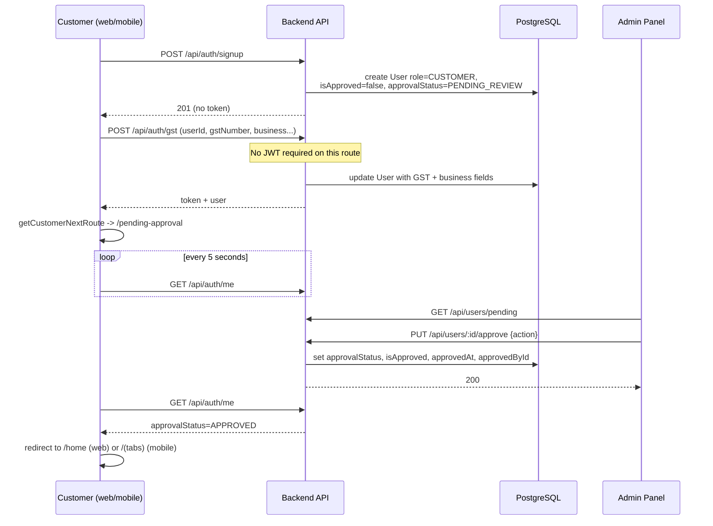

| From State | Event | To State | Who triggers it |
| --- | --- | --- | --- |
| *(none)* | `POST /api/auth/signup` | `PENDING_REVIEW`, `isApproved=false` | Customer |
| `PENDING_REVIEW` | `POST /api/auth/gst` | `PENDING_REVIEW` + GST populated | Customer (unauthenticated route) |
| `PENDING_REVIEW` | `PUT /api/users/:id/approve` with `action=approve` | `APPROVED`, `isApproved=true`, `approvedAt` set | Admin |
| `PENDING_REVIEW` | `PUT /api/users/:id/approve` with `action=reject` | `REJECTED` + `rejectionReason` | Admin |
| `REJECTED` | `POST /api/auth/login` | login blocked | Backend guard |

### 7.2 Order creation, reservation and auto-assignment

Every checkout path funnels into `placeOrderLine()` (`app/lib/place-order.ts`) or the near-identical inline logic in `POST /api/orders`. The critical detail is that **stock is reserved logically at checkout but not physically decremented**.

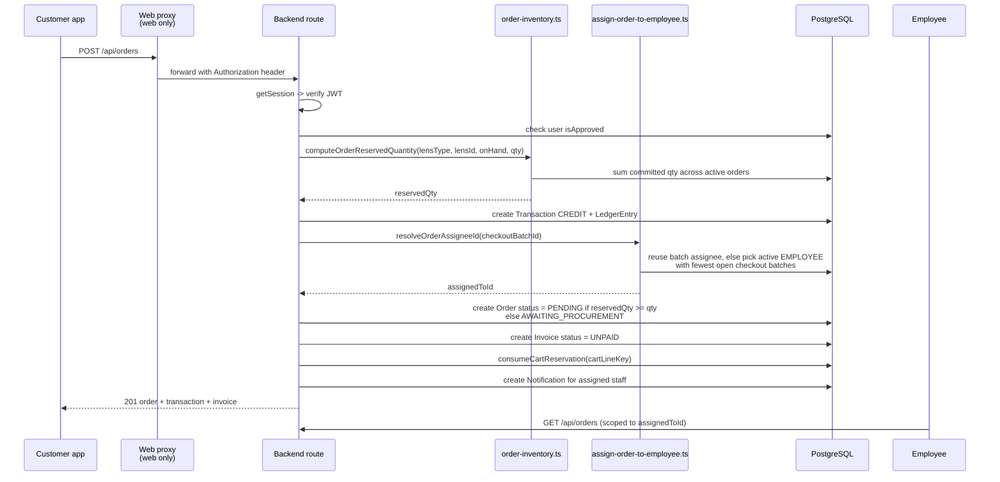

**Assignment algorithm** (`app/lib/assign-order-to-employee.ts`):

1. If the order has a `checkoutBatchId` and an earlier order in that batch already has an assignee, reuse it — this keeps every line of one checkout with the same employee.
2. Otherwise list all `EMPLOYEE` users with `isActive = true`, ordered by `createdAt`.
3. Count each employee's **open checkout batches** (distinct `checkoutBatchId`, falling back to order id) where status is one of `PENDING`, `PICKING`, `PACKED`, `DISPATCHED`, `PARTIALLY_FULFILLED`, `AWAITING_PROCUREMENT`.
4. Return the employee with the lowest count; return `null` if no active employees exist (the order is then unassigned).

| From State | Event | To State | Who triggers it |
| --- | --- | --- | --- |
| *(none)* | checkout with `reservedQty >= quantity` | `PENDING` | Customer, or staff on behalf |
| *(none)* | checkout with `reservedQty < quantity` | `AWAITING_PROCUREMENT` | Customer, or staff on behalf |
| *(none)* | order created | `Invoice = UNPAID`, `Transaction = COMPLETED` (CREDIT) | System |
| *(none)* | order created | `assignedToId` set, `assignedAt` stamped | System (least-load) |

### 7.3 Fulfilment state machine

`app/lib/order-status-transitions.ts` is the single canonical map. It is **not role-differentiated** — `getStaffStatusOptions()` returns the same options for `ADMIN` and `EMPLOYEE`. Role differences are layered on top by the route handler.

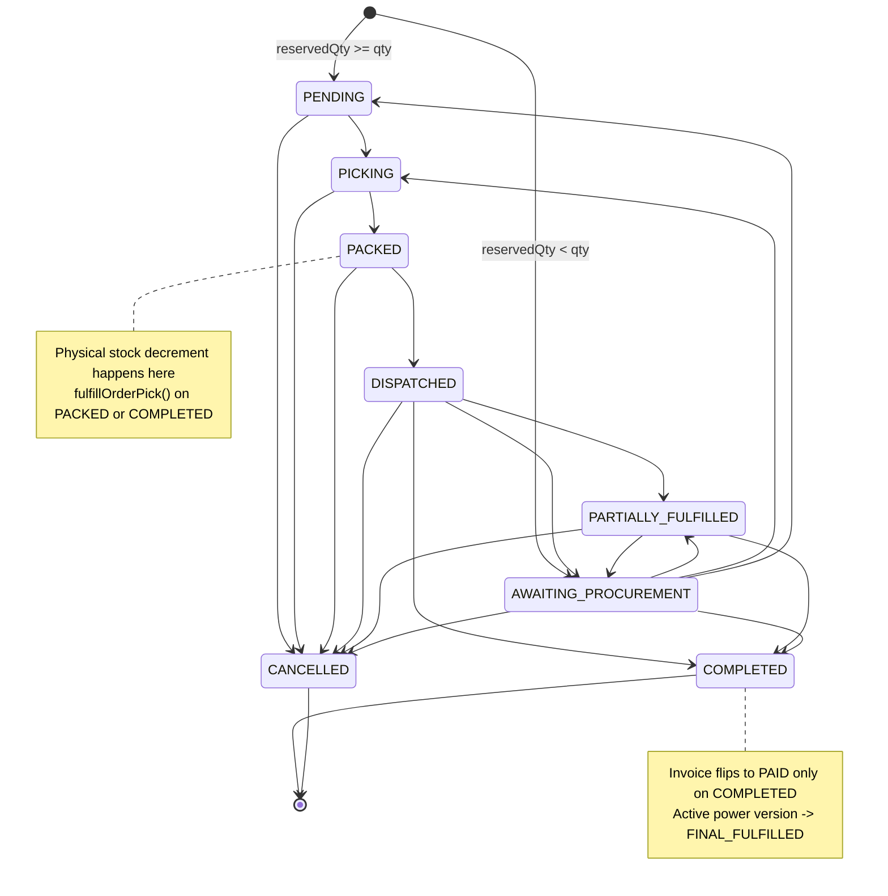

| From State | Event | To State | Who triggers it |
| --- | --- | --- | --- |
| `PENDING` | start picking | `PICKING` | Employee (assigned), Admin |
| `PENDING` | cancel | `CANCELLED` | Customer, Employee (assigned), Admin |
| `PICKING` | packing done | `PACKED` — **stock physically decremented** | Employee (assigned), Admin |
| `PACKED` | hand to courier | `DISPATCHED` | Employee (assigned), Admin |
| `DISPATCHED` | partial delivery | `PARTIALLY_FULFILLED` | Employee (assigned), Admin |
| `DISPATCHED` | shortfall found | `AWAITING_PROCUREMENT` | Employee (assigned), Admin |
| `DISPATCHED` | delivery confirmed | `COMPLETED` — **Invoice → `PAID`**, power version → `FINAL_FULFILLED` | Employee (assigned), Admin |
| `PARTIALLY_FULFILLED` | remainder sourced | `COMPLETED` | Employee (assigned), Admin |
| `AWAITING_PROCUREMENT` | stock intake covers full qty | `PENDING` | System via `fulfillProcurementOrder()` |
| `AWAITING_PROCUREMENT` | stock intake covers part | `PARTIALLY_FULFILLED` | System via `fulfillProcurementOrder()` |
| `AWAITING_PROCUREMENT` | cancel by customer | `CANCELLED` | Customer |
| any except `COMPLETED` | `force: true` | `CANCELLED` | **Admin only** |
| `CANCELLED` | any transition | rejected, HTTP 400 | Backend guard |
| `COMPLETED` | any transition | rejected — options list is empty | Backend guard |

### 7.4 Procurement and stock intake

Stock intake is modelled as a **procurement expense**. Recording one against an `AWAITING_PROCUREMENT` order recomputes coverage and moves the order forward automatically.

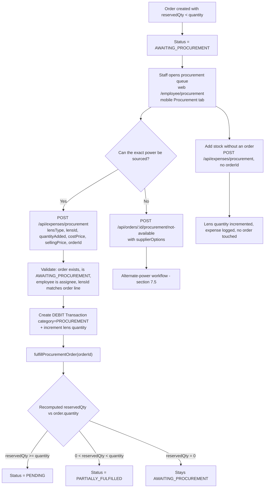

| From State | Event | To State | Who triggers it |
| --- | --- | --- | --- |
| `AWAITING_PROCUREMENT` | stock intake, full coverage | `PENDING` | Employee (assigned) or Admin, applied by system |
| `AWAITING_PROCUREMENT` | stock intake, partial coverage | `PARTIALLY_FULFILLED` | Employee (assigned) or Admin, applied by system |
| `AWAITING_PROCUREMENT` | stock intake, no coverage | `AWAITING_PROCUREMENT` | — |
| `AWAITING_PROCUREMENT` | power cannot be sourced | power version → `POWER_NOT_AVAILABLE`, `reservedQuantity = 0` | Employee, Admin |
| any | standalone stock intake | lens `quantity` incremented, `Transaction` DEBIT `PROCUREMENT` | Employee, Admin |

### 7.5 Alternate-power suggestion and acceptance

This is the platform's most distinctive workflow: when the exact prescribed power is unavailable, the system offers ranked substitutes and **only the customer can accept one**. Applies to **retail orders only** (`assertRetailOrder()`).

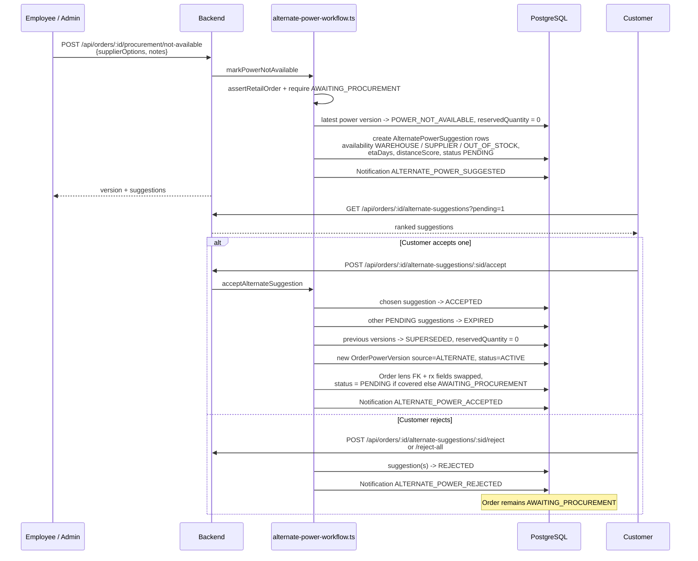

**Power version transitions** (`OrderPowerVersion.status`):

| From State | Event | To State | Who triggers it |
| --- | --- | --- | --- |
| *(none)* | order placed / first snapshot | `ACTIVE`, `source = ORIGINAL` | System |
| `ACTIVE` | staff marks power unavailable | `POWER_NOT_AVAILABLE` | Employee, Admin |
| `ACTIVE` or `POWER_NOT_AVAILABLE` | customer accepts an alternate | `SUPERSEDED` | Customer |
| *(none)* | customer accepts an alternate | new version `ACTIVE`, `source = ALTERNATE` | Customer |
| `ACTIVE` | order reaches `PACKED` / `DISPATCHED` / `COMPLETED` | `FINAL_FULFILLED`, `isFinalFulfilled = true` | System via `markActiveVersionFinalFulfilled()` |

**Suggestion transitions** (`AlternatePowerSuggestion.status`):

| From State | Event | To State | Who triggers it |
| --- | --- | --- | --- |
| *(none)* | staff marks power unavailable | `PENDING` | Employee, Admin |
| `PENDING` | customer accepts this one | `ACCEPTED` | Customer |
| `PENDING` | customer rejects this one, or rejects all | `REJECTED` | Customer |
| `PENDING` | a sibling suggestion was accepted | `EXPIRED` | System |

### 7.6 Returns and replacements

Employees can only gather information. **Every outcome is decided by an admin**, who must simultaneously choose a stock disposition and assign an active employee.

```mermaid
sequenceDiagram
    participant C as Customer
    participant BE as Backend
    participant E as Employee
    participant A as Admin
    participant DB as PostgreSQL

    C->>BE: POST /api/returns {requestType, items[], reason}
    BE->>DB: ReturnRequest status = SUBMITTED + items + timeline SUBMITTED
    C->>BE: POST /api/returns/:id/images
    BE->>DB: ReturnRequestImage + timeline PHOTO_ADDED

    opt More information needed
        E->>BE: PATCH /api/returns/:id {action: "more-info"}
        BE->>DB: status = MORE_INFO_REQUIRED + timeline
        C->>BE: POST /api/returns/:id/images (adds evidence)
    end

    A->>BE: POST /api/returns/:id/decision<br/>{decision, stockDisposition, assignedEmployeeId, remarks, approvedAmount}
    BE->>BE: reject unless status in SUBMITTED / MORE_INFO_REQUIRED / ESCALATED_TO_ADMIN
    BE->>BE: require active EMPLOYEE for CREDIT and REPLACEMENT

    alt decision = CREDIT
        BE->>DB: InventoryMovement per item with disposition
        BE->>DB: if RETURN_TO_SALEABLE then incrementLensStock
        BE->>DB: CreditNote + CreditNoteAllocation(s) (tax-inclusive invoice credit; no unitPrice×qty fallback)
        BE->>DB: status = APPROVED_CREDIT + timeline APPROVED_CREDIT
    else decision = REPLACEMENT
        BE->>DB: InventoryMovement per item
        BE->>DB: new Order per item, batch RET-REPL-timestamp,<br/>unitPrice 0, notes [Replacement Order], assigned to employee
        BE->>DB: Invoice amount 0 status PAID per replacement order
        BE->>DB: status = AWAITING_MATERIAL + timeline APPROVED_REPLACEMENT
    else decision = REJECT
        BE->>BE: require non-empty remarks
        BE->>DB: status = REJECTED + rejectionReason + timeline REJECTED
    end

    BE->>DB: Notification RETURN_REQUEST_DECIDED to customer
    BE->>DB: Notification to assigned employee (non-reject)
```

| From State | Event | To State | Who triggers it |
| --- | --- | --- | --- |
| *(none)* | `POST /api/returns` | `SUBMITTED` | Customer, or staff on behalf |
| `SUBMITTED` | `action=more-info` | `MORE_INFO_REQUIRED` | Employee (assigned), Admin |
| `SUBMITTED` / `MORE_INFO_REQUIRED` | `action=escalate` | `ESCALATED_TO_ADMIN` | **Admin only** — employees are refused |
| `SUBMITTED` / `MORE_INFO_REQUIRED` / `ESCALATED_TO_ADMIN` | `decision=CREDIT` | `APPROVED_CREDIT` + `CreditNote` | Admin |
| `SUBMITTED` / `MORE_INFO_REQUIRED` / `ESCALATED_TO_ADMIN` | `decision=REPLACEMENT` | `AWAITING_MATERIAL` + replacement orders | Admin |
| `SUBMITTED` / `MORE_INFO_REQUIRED` / `ESCALATED_TO_ADMIN` | `decision=REJECT` (remarks required) | `REJECTED` | Admin |
| any | `action=close` | `CLOSED` | Admin |
| `APPROVED_CREDIT` / `APPROVED_REPLACEMENT` / `REJECTED` / `CLOSED` | further decision attempt | rejected, HTTP 400 | Backend guard |

**Stock disposition** decides what happens to returned material: `RETURN_TO_SALEABLE` (only this one increments lens stock), `DAMAGED_STOCK`, `SEND_TO_IMPORTER`, `SCRAP`. Every item generates an `InventoryMovement` row regardless of disposition.

### 7.7 Cart reservation lifecycle

Cart lines persist server-side for 7 days and are cleaned up by a cron endpoint rather than a scheduler inside the app.

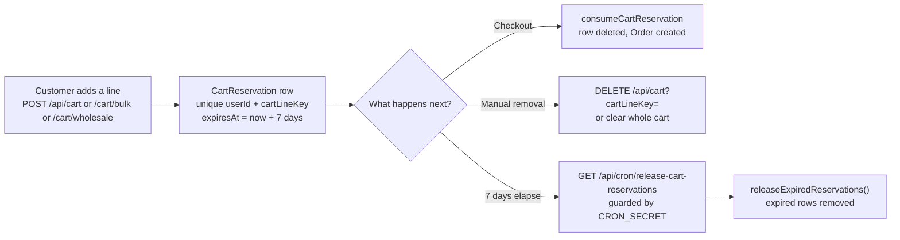

Note: `CART_LINE_TTL_MS = 7 * 24 * 60 * 60 * 1000` in `app/lib/cart-reservations.ts`. Cart lines **do not** hold physical stock — `upsertCartReservation` is documented as persisting "a cart line without reserving or decrementing inventory".

### 7.8 Task assignment

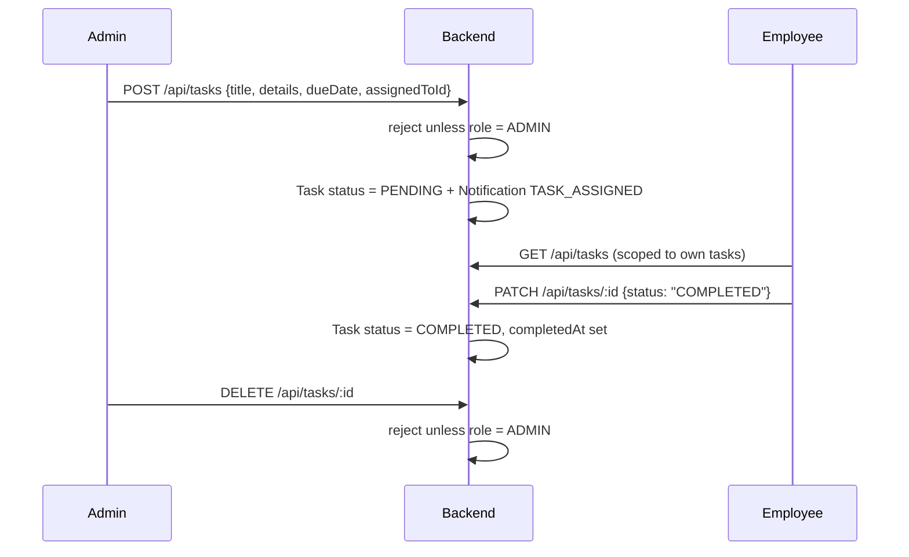

| From State | Event | To State | Who triggers it |
| --- | --- | --- | --- |
| *(none)* | `POST /api/tasks` | `PENDING` | **Admin only** |
| `PENDING` | `PATCH` with `status=COMPLETED` | `COMPLETED`, `completedAt` set | Employee (own task), Admin |
| `COMPLETED` | `PATCH` with `status=PENDING` | `PENDING` | Employee (own task), Admin |
| any | `DELETE /api/tasks/:id` | deleted | **Admin only** |

---

## 8. Data Model Overview

Source: `prisma/schema.prisma` — 826 lines, **28 models**, **24 enums**, PostgreSQL. Split into two diagrams for legibility.

### 8.1 Identity, catalog, cart, orders and fulfilment

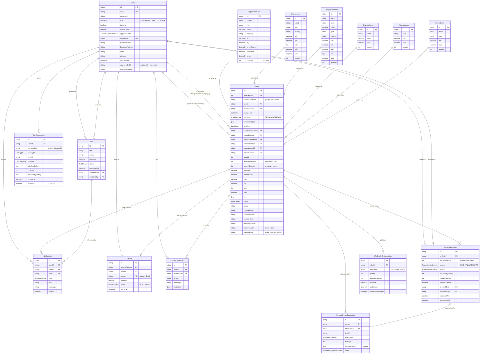

### 8.2 Returns, finance and configuration

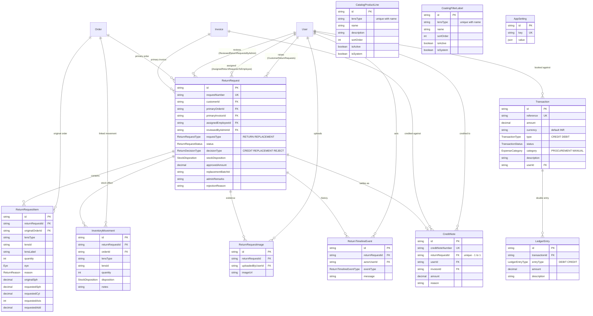

### 8.3 Complete enum reference

| Enum | Values |
| --- | --- |
| `UserRole` | `ADMIN`, `EMPLOYEE`, `CUSTOMER` |
| `AccountApprovalStatus` | `PENDING_REVIEW`, `APPROVED`, `REJECTED` |
| `LensType` | `SINGLE_VISION`, `KRYPTOK`, `PROGRESSIVE`, `ORI_VISION`, `MAGNUS`, `BIFOCAL` |
| `OrderStatus` | `PENDING`, `PICKING`, `PACKED`, `DISPATCHED`, `PARTIALLY_FULFILLED`, `AWAITING_PROCUREMENT`, `COMPLETED`, `CANCELLED` |
| `CartLineType` | `RETAIL`, `WHOLESALE` |
| `Eye` | `LEFT`, `RIGHT` |
| `InvoiceStatus` | `PAID`, `UNPAID` |
| `TransactionType` | `CREDIT`, `DEBIT` |
| `TransactionStatus` | `PENDING`, `COMPLETED`, `FAILED` |
| `LedgerEntryType` | `DEBIT`, `CREDIT` |
| `ExpenseCategory` | `PROCUREMENT`, `MANUAL` |
| `PowerVersionSource` | `ORIGINAL`, `ALTERNATE` |
| `PowerVersionStatus` | `ACTIVE`, `SUPERSEDED`, `POWER_NOT_AVAILABLE`, `FINAL_FULFILLED` |
| `AlternateAvailability` | `WAREHOUSE`, `SUPPLIER`, `OUT_OF_STOCK` |
| `AlternateSuggestionStatus` | `PENDING`, `ACCEPTED`, `REJECTED`, `EXPIRED` |
| `ReturnRequestType` | `RETURN`, `REPLACEMENT` |
| `ReturnRequestStatus` | `SUBMITTED`, `MORE_INFO_REQUIRED`, `ESCALATED_TO_ADMIN`, `AWAITING_MATERIAL`, `APPROVED_CREDIT`, `APPROVED_REPLACEMENT`, `REJECTED`, `CLOSED` |
| `ReturnReason` | `WRONG_POWER`, `MANUFACTURING_DEFECT`, `COATING_ISSUE`, `BROKEN_IN_TRANSPORT`, `WRONG_PRODUCT`, `EXCESS_STOCK_RETURN`, `OTHER` |
| `ReturnDecisionType` | `CREDIT`, `REPLACEMENT`, `REJECT` |
| `StockDisposition` | `RETURN_TO_SALEABLE`, `DAMAGED_STOCK`, `SEND_TO_IMPORTER`, `SCRAP` |
| `ReturnTimelineEventType` | `SUBMITTED`, `PHOTO_ADDED`, `MORE_INFO_REQUIRED`, `ESCALATED`, `APPROVED_CREDIT`, `APPROVED_REPLACEMENT`, `REJECTED`, `CLOSED` |
| `TaskStatus` | `PENDING`, `COMPLETED` |
| `NotificationType` | `ORDER_STATUS_UPDATED`, `ORDER_PLACED`, `TASK_ASSIGNED`, `RETURN_REQUEST_SUBMITTED`, `RETURN_REQUEST_UPDATED`, `RETURN_REQUEST_DECIDED`, `ALTERNATE_POWER_SUGGESTED`, `ALTERNATE_POWER_ACCEPTED`, `ALTERNATE_POWER_REJECTED` |

### 8.4 Modelling notes worth knowing

- **Polymorphic lens reference.** `Order` carries six nullable lens foreign keys plus a `lensType` discriminator. Exactly one FK is populated. There is no shared `Product` table, so every lens-touching helper (`getOrderLensId`, `incrementLensStock`, `decrementLensStock`) is a six-way switch — and `decrementLensStock` currently handles only three of the six families.
- **Two orphan scalar FKs with no Prisma relation:** `User.approvedById` and `Order.transactionId`. They store ids but cannot be traversed or referentially enforced.
- **`ReturnRequestStatus.APPROVED_REPLACEMENT` is never written.** A replacement approval sets `AWAITING_MATERIAL`; only the *timeline event* uses `APPROVED_REPLACEMENT`.
- **No many-to-many relations anywhere.** Every association is a one-to-many or one-to-one via explicit FK.
- **`CatalogProductLine.lensType` and `CoatingFilterLabel.lensType` are plain strings** (`"single-vision"`, `"kryptok"`, `"progressive"`), not the `LensType` enum — a naming/typing inconsistency with the rest of the schema.
- **Three lens families are modelled but not merchandised.** `OriVisionLens`, `MagnusLens`, and `BifocalLens` have tables and order FKs, but no catalog API route exposes them and no shop screen reaches them.

---

## 9. Cross-Repo Integration Map

The three repos form a hub-and-spoke topology. The backend is the only thing that touches the database. Web goes through a server-side proxy; mobile goes direct.

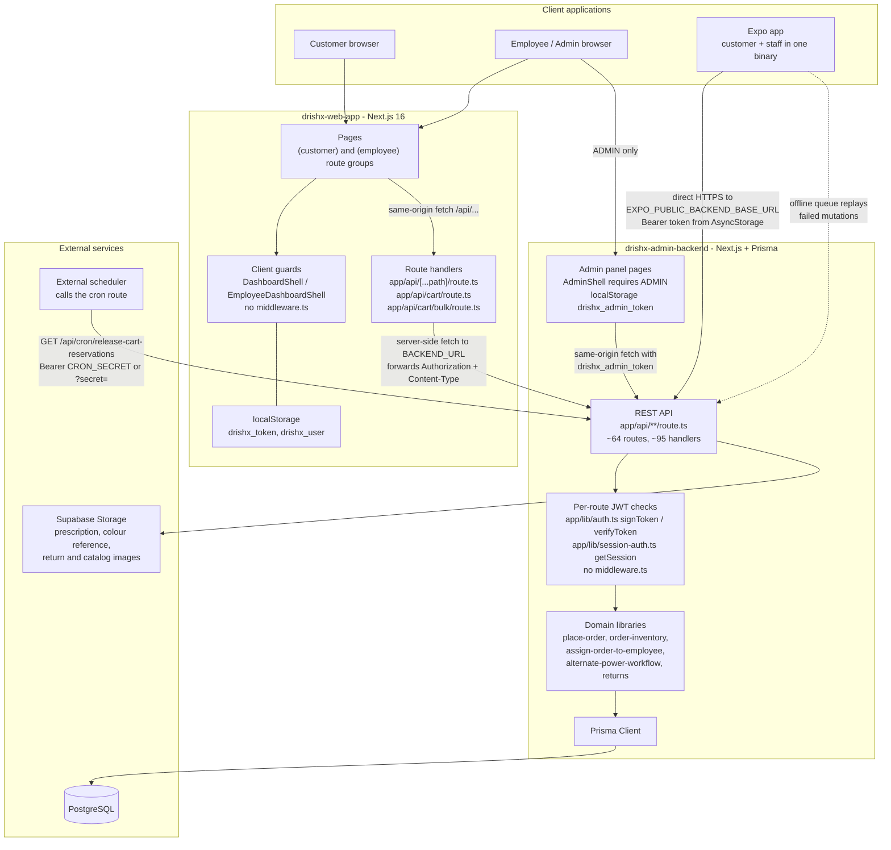

### 9.1 Integration facts

| Aspect | Detail |
| --- | --- |
| **Web → backend** | Server-side proxy. `lib/backend-url.ts` reads `BACKEND_URL` (default `http://127.0.0.1:3000`); current `.env.local` points at `https://drishx-admin-backend.vercel.app`. The catch-all handler rewrites `/api/{path}` to `{BACKEND_URL}/api/{path}`, forwards `Authorization` and `Content-Type`, uses `cache: "no-store"`, and returns `502` if the backend is unreachable. |
| **Mobile → backend** | Direct. `lib/api-config.ts` validates `EXPO_PUBLIC_BACKEND_BASE_URL` at startup. No proxy hop. |
| **Shared auth** | One JWT format everywhere: `{ userId, role }`, HS256 via `jsonwebtoken`, `expiresIn: "7d"`, secret `process.env.JWT_SECRET` with the fallback literal `"please_change_this_secret"`. A token minted by any client works against any surface. |
| **Token storage differs per client** | Web: `localStorage` (`drishx_token`, `drishx_user`). Admin panel: `localStorage` (`drishx_admin_token`, `drishx_admin_user`) — a **separate key namespace** on the same origin family. Mobile: `AsyncStorage` under `@drishx/auth-session` — **not** `expo-secure-store`. |
| **No webhooks** | Nothing in any repo registers, sends, or receives a webhook. All communication is synchronous request/response. |
| **No API versioning** | There is no `/api/v1` prefix. All routes are flat under `/api`. |
| **No shared package** | The three repos duplicate types and logic by copy rather than importing a common library. `getStaffStatusOptions()` exists independently in the backend (`app/lib/order-status-transitions.ts`), again in the backend admin UI (`app/lib/admin-orders.ts`), and again in the mobile app (`lib/order-tracking.ts`). |
| **File uploads** | All image uploads (RX prescriptions, colour references, return evidence, catalog images) go to Supabase Storage through backend routes; clients receive signed URLs via `getSignedOrderImageUrl()`. |
| **Offline support is mobile-only** | `lib/api-request.ts` wraps mutations in an offline queue persisted to AsyncStorage and replays them with the current token; reads such as the orders list fall back to an AsyncStorage cache. The web app has no equivalent. |
| **Scheduling is external** | The only scheduled job is `GET /api/cron/release-cart-reservations`. Nothing in the repos schedules it; an external caller must. |

---

## 10. Gaps & Inconsistencies Found

Ordered by operational severity. Every item below is a place where the code contradicts itself or where a guard is weaker than the UI implies.

### 10.1 Security gaps

| # | Issue | Evidence | Impact |
| --- | --- | --- | --- |
| 1 | **Lens edit and delete are completely unauthenticated** while lens *creation* requires `ADMIN`. | `app/api/lenses/single-vision/[id]/route.ts`, `kryptok/[id]/route.ts`, `progressive/[id]/route.ts` export `PUT` and `DELETE` with no `getSession()` call; the sibling collection routes use `requireAdmin`. | Anyone on the internet can rewrite prices and stock quantities, or delete SKUs. Highest-severity finding. |
| 2 | **GST submission requires no authentication** and trusts a `userId` from the request body. | `app/api/auth/gst/route.ts` | Anyone who can guess or obtain a user id can overwrite that shop's GST number, business name, and address — and the endpoint returns a **valid JWT** for that user. |
| 3 | **Staff-created customers get a plaintext default password.** | `app/api/orders/route.ts` — `password: user.password \|\| "defaultPassword123!"` with the comment `// Should be hashed in a real scenario`. The value bypasses `hashPassword()`. | Accounts created through the on-behalf order flow have an unhashed, publicly known credential. |
| 4 | **Cron endpoint is fully open when `CRON_SECRET` is unset.** | `app/api/cron/release-cart-reservations/route.ts` — the auth branch is `if (secret && ...)`, so a missing env var skips the check entirely. | Any caller can wipe expired cart reservations. Low blast radius, but the pattern is unsafe. |
| 5 | **Entire lens catalog, stock counts, coatings, and catalog images are public.** | `app/api/lenses/route.ts`, `/items`, `/coatings`, `/siblings`, `/related`, `/catalog-images` have no session check. | Competitor-visible inventory levels and pricing for a B2B wholesale business. |
| 6 | **JWT secret has a hard-coded fallback.** | `app/lib/auth.ts` — `process.env.JWT_SECRET \|\| "please_change_this_secret"` | A deployment missing the env var silently accepts forged tokens signed with a public constant. |
| 7 | **Mobile staff screens have no route-level role guard.** | Only `app/(tabs)/_layout.tsx` enforces sign-in and hides staff tabs via `href: null`. `app/order-details.tsx`, `app/inventory.tsx`, `app/employee-order-on-behalf.tsx`, and the Procurement tab have no guard of their own. | A signed-in customer can deep-link into staff screens. The backend still rejects the writes, but staff-only data may render. |
| 8 | **Token stored in AsyncStorage, not SecureStore.** | `lib/auth.tsx` key `@drishx/auth-session` | On a rooted/jailbroken device the 7-day JWT is readable in plain text. |

### 10.2 Backend guard vs frontend UI divergence

| # | Issue | Backend says | Frontend does |
| --- | --- | --- | --- |
| 9 | **Customer cancel exists in the API and on mobile but not on web.** | `PUT /api/orders/:id` explicitly permits a customer to set `CANCELLED` from `PENDING` or `AWAITING_PROCUREMENT`. | Web defines `cancelOrder()` in `lib/orders-api.ts` and **never calls it from any component**. Mobile wires it into `app/(tabs)/my-orders.tsx`. A customer therefore has different rights depending on which client they open. |
| 10 | **Mobile status bottom sheet ignores the transition map.** | `getStaffStatusOptions()` returns only the legal next statuses, and `PUT /api/orders/:id` rejects anything else with `400 Invalid status transition`. | `components/employee-order-range-sheet.tsx` renders a hard-coded `ALL_ORDER_STATUSES` array of all 8 statuses. Staff can tap `COMPLETED` on a `PENDING` order and receive an avoidable server error. Note the same file's sibling, `employee-photo-order-detail.tsx`, does it correctly. |
| 11 | **Photo orders can be created only on mobile, but are read on all clients.** | `POST /api/orders/photo` is `CUSTOMER`-only and fully implemented. | Web has no creation UI. `lib/order-list-display.ts` reverse-detects photo orders with `isPhotoOrder()` by checking `orderImageUrl` and the absence of `[RX Order]`/`[Color Lens]` markers. |
| 12 | **Order type is encoded in a free-text `notes` string, not a column.** | Schema has no order-kind discriminator. | Both clients classify orders by string-matching `[RX Order]`, `[Color Lens]`, `[Replacement Order]` prefixes in `notes`. Any edit to that field silently reclassifies the order. |
| 13 | **Web has no `AdminShell`; admins and employees see the same staff portal.** | Backend distinguishes the roles on many endpoints. | `drishx-web-app` routes both roles into `EmployeeDashboardShell`. Admin-only differences are ad-hoc in-component checks, so an admin using the web portal cannot reach admin-only actions such as return decisions or customer approval — they must switch to the Admin Panel. |
| 14 | **All guards in web and mobile are client-side only.** | The backend is the sole real enforcement point. | No `middleware.ts` in either repo; `DashboardShell`, `EmployeeDashboardShell`, and the Expo tab layout all guard inside `useEffect`. Protected pages briefly mount before redirecting. |

### 10.3 Logic and modelling inconsistencies

| # | Issue | Evidence |
| --- | --- | --- |
| 15 | **`getStaffStatusOptions()` is triplicated** across `app/lib/order-status-transitions.ts`, `app/lib/admin-orders.ts` (identical switch), and mobile `lib/order-tracking.ts`. Three copies must be edited in lockstep. |
| 16 | **`decrementLensStock()` handles only 3 of 6 lens families** — Single Vision, Kryptok, Progressive. Orders on OriVision, Magnus, or Bifocal would silently skip the stock decrement. |
| 17 | **Return escalation is unreachable in practice.** `PATCH /api/returns/:id` with `action=escalate` is `ADMIN`-only, and the error message states "Employees cannot escalate. Returns are reviewed by admin first." Escalating *to* admin as an admin is a no-op; `ESCALATED_TO_ADMIN` is effectively a vestigial state. |
| 18 | **`APPROVED_REPLACEMENT` status is never persisted.** A replacement approval writes `AWAITING_MATERIAL` to `ReturnRequest.status`; the enum value is used only as a timeline event type. |
| 19 | **Comment contradicts code in `POST /api/orders`.** The header comment reads `// Access: ADMIN | EMPLOYEE`, but the handler explicitly permits `CUSTOMER`. |
| 20 | **Inconsistent 401 vs 403.** Several handlers return `403 Forbidden` when there is no session at all, where the rest of the API returns `401`. Affected: `/api/users/*`, `DELETE /api/tasks/:id`, `POST /api/returns/:id/decision`. |
| 21 | **`GET /api/invoices` is unscoped for non-customers.** The handler narrows to `session.userId` only when the role is `CUSTOMER`; it has no explicit `ADMIN`/`EMPLOYEE` check, so any authenticated non-customer token lists every invoice in the system. |
| 22 | **`resolveOrderUrl` on the client resolves to localhost.** `resolveOrderImageUrl()` in the web app's `lib/orders-api.ts` calls `getBackendUrl()`, which reads the **server-only** `process.env.BACKEND_URL`. In the browser that is `undefined`, so relative image paths fall back to `http://127.0.0.1:3000`. |
| 23 | **White/clear catalog is hard-coded client data with no backend.** `lib/white-catalog.ts` exists separately in both the web and mobile repos, and drives `/white/**` with synthetic lens items. Two copies to keep in sync, and nothing validates against real stock. |
| 24 | **Two orphan foreign keys** — `User.approvedById` and `Order.transactionId` — store ids without a Prisma relation, so they carry no referential integrity and cannot be joined. |
| 25 | **`lensType` typing is inconsistent.** `Order`, `CartReservation`, and the workflow libraries use the `LensType` enum; `CatalogProductLine`, `CoatingFilterLabel`, `ReturnRequestItem`, and `InventoryMovement` use plain lowercase strings. |
| 26 | **Mobile staff role label is hard-coded.** `app/(tabs)/index.tsx` displays "Operations Manager" for every staff user regardless of whether they are `ADMIN` or `EMPLOYEE`. |
| 27 | **Misleading module name.** `lib/home-categories-api.ts` in the mobile app performs no network call; it exports the client-side constant `CLIENT_HOME_CATEGORIES`. |
| 28 | **`GET /api/users/customers` has a silent fallback.** `lib/customers-api.ts` in both clients falls back to de-duplicating customers out of `GET /api/orders` if the customers endpoint fails, so the on-behalf picker can quietly show a partial list. |
| 29 | **`requireAdmin` is copy-pasted, not shared.** The same 10-line helper is redefined in nine route files instead of living in `app/lib/`. Several other routes inline their own `getSession` rather than importing `app/lib/session-auth.ts`. |

---

## 11. Not Yet Implemented / TODO

### 11.1 Admin sidebar labels with no destination

These render in `components/admin-sidebar.tsx` without an `href` and are styled `cursor-default` — they are product intent, not features.

| Section | Item |
| --- | --- |
| Inventory | Purchase Management |
| Inventory | Smart Alerts |
| Client & CRM | Loyalty & Wallet |
| Employee & HR | Roles & Permissions |
| Employee & HR | Attendance |
| Employee & HR | Performance |
| Employee & HR | Payroll & Incentives |
| Finance | Receivables |
| Finance | Payables |
| Finance | Reports |
| System | Audit Logs |
| Upcoming | AI Center — carries a "New" badge |

Note the irony of **Roles & Permissions** being a stub: the platform has no RBAC data model at all, only hard-coded role literals.

### 11.2 Pages that exist but say "Coming soon"

| Repo | Route | File |
| --- | --- | --- |
| Backend | `/` — the admin dashboard itself | `app/page.tsx` |
| Backend | `/inventory/power-wise-stock` | `app/inventory/power-wise-stock/page.tsx` |
| Backend | `/inventory/products-catalog` | `app/inventory/products-catalog/page.tsx` |
| Web | `/profile/coming-soon?feature=billing-address` | `app/(customer)/profile/coming-soon/page.tsx` |
| Web | `/profile/coming-soon?feature=outstanding-payments` | same |
| Web | `/profile/coming-soon?feature=support` | same |
| Mobile | Billing Address / Payments / Support | `app/profile-placeholder.tsx` |
| Mobile | Unknown colour mode fallback | `app/color/[mode].tsx` |

### 11.3 Entire capability areas absent from the code

| Missing capability | What exists instead |
| --- | --- |
| **Payments** | No payment service provider, no payment intent, no settlement endpoint. `Invoice.status` flips `UNPAID → PAID` purely as a side effect of the order reaching `COMPLETED` in `PUT /api/orders/:id`. Row 37 of the permission matrix is "No" for every role. |
| **Discounts, promotions, price tiers** | `unitPrice` is copied straight from the lens row. No discount field anywhere in the schema. |
| **Credit limits / receivables ageing** | `CreditNote` exists for returns only. No credit-limit field on `User`, no ageing logic, Receivables and Payables are sidebar stubs. |
| **Loyalty and wallet** | Sidebar stub only. No model, no endpoint. |
| **RBAC / custom roles / permission management** | Three hard-coded enum values and per-route `if` statements. No `Role`, `Permission`, or assignment table. |
| **Attendance, performance, payroll** | Sidebar stubs. `Task` is the only employee-productivity artefact. |
| **Audit logging as a product feature** | `OrderActivityLog` and `ReturnTimelineEvent` capture order and return history, but there is no cross-entity audit trail and no UI to browse one. |
| **Reporting and analytics** | No aggregate or report endpoint. Every dashboard number is computed client-side from list responses. |
| **Notification delivery beyond in-app** | `Notification` rows are created and read via `GET /api/notifications`. No email, SMS, or push transport exists — Expo push is not configured. |
| **Webhooks / event bus** | Nothing publishes or consumes events. All integration is synchronous HTTP. |
| **API versioning** | Flat `/api` namespace; no `/v1`. |

### 11.4 Modelled but not merchandised

| Item | State |
| --- | --- |
| `OriVisionLens` | Table exists, `Order.oriVisionLensId` FK exists, replacement-order logic copies it. **No catalog API route, no shop screen, and no branch in `decrementLensStock`.** |
| `MagnusLens` | Same as above. |
| `BifocalLens` | Same as above. The web wholesale matrix screen contains bifocal ADD-range handling, but there is no way to reach a bifocal SKU. |
| `ReturnRequestStatus.APPROVED_REPLACEMENT` | Enum value never written to the status column. |
| `ReturnRequestStatus.ESCALATED_TO_ADMIN` | Only an admin can set it, which makes it functionally unreachable. |
| `Transaction.status = PENDING / FAILED` | Enum values exist; all created transactions are `COMPLETED`. |
| `AlternateAvailability.OUT_OF_STOCK` | Modelled, but suggestion generation practically yields `WAREHOUSE` or `SUPPLIER`. |

### 11.5 Dead or scaffolding code

| Repo | File | Note |
| --- | --- | --- |
| Web | `components/dashboard/coming-soon.tsx` | Defined, mounted by no page. |
| Web | `components/employee/employee-coming-soon.tsx` | Defined, mounted by no page. |
| Mobile | `app/modal.tsx` | Unmodified Expo template modal ("This is a modal"). |
| Backend | `abc.t`, `abc.taxt`, `abc.txt` | Stray scratch files in the repo root. |
| Backend | `app/lib/admin-orders.ts` lines ~155-179 | Verbatim duplicate of the canonical transition switch. |

### 11.6 No explicit TODO markers

A search across all three repos found **no `TODO` or `FIXME` comments**. The only in-code acknowledgement of incomplete work is the inline note on the plaintext default password in `app/api/orders/route.ts`:

```ts
password: user.password || "defaultPassword123!", // Should be hashed in a real scenario
```

Everything else in this section is structural — stub pages, hrefless labels, unreferenced components, and enum values with no writer — rather than commented technical debt.

---

## Appendix A — Quick reference: authoritative files

| Concern | File |
| --- | --- |
| Prisma schema (28 models, 24 enums) | `drishx-admin-backend/prisma/schema.prisma` |
| JWT sign / verify, password hashing | `drishx-admin-backend/app/lib/auth.ts` |
| Bearer token extraction | `drishx-admin-backend/app/lib/session-auth.ts` |
| Canonical order status transitions | `drishx-admin-backend/app/lib/order-status-transitions.ts` |
| Order status enforcement, force-cancel, invoice flip | `drishx-admin-backend/app/api/orders/[id]/route.ts` |
| Shared order placement | `drishx-admin-backend/app/lib/place-order.ts` |
| Reservation and physical stock movement | `drishx-admin-backend/app/lib/order-inventory.ts`, `app/lib/cart-reservations.ts` |
| Least-load employee assignment | `drishx-admin-backend/app/lib/assign-order-to-employee.ts` |
| Alternate-power state machine | `drishx-admin-backend/app/lib/alternate-power-workflow.ts` |
| Return decision (credit / replacement / reject) | `drishx-admin-backend/app/api/returns/[id]/decision/route.ts` |
| Admin panel role gate | `drishx-admin-backend/components/admin-shell.tsx` |
| Admin sidebar, including stubs | `drishx-admin-backend/components/admin-sidebar.tsx` |
| Web backend proxy | `drishx-web-app/app/api/[...path]/route.ts` |
| Web backend URL resolution | `drishx-web-app/lib/backend-url.ts` |
| Web customer guard | `drishx-web-app/components/dashboard/dashboard-shell.tsx` |
| Web staff guard | `drishx-web-app/components/employee/employee-dashboard-shell.tsx` |
| Web order-kind classification | `drishx-web-app/lib/order-list-display.ts` |
| Web wholesale matrix builder | `drishx-web-app/components/wholesale/wholesale-order-screen.tsx` |
| Mobile backend base URL | `drishx-mobile-app/lib/api-config.ts` |
| Mobile auth, token storage, `isStaffRole` | `drishx-mobile-app/lib/auth.tsx` |
| Mobile onboarding routing | `drishx-mobile-app/lib/auth-api.ts` |
| Mobile tab guard and role-based tabs | `drishx-mobile-app/app/(tabs)/_layout.tsx` |
| Mobile duplicate transition map | `drishx-mobile-app/lib/order-tracking.ts` |
| Mobile status sheet (all-statuses bug) | `drishx-mobile-app/components/employee-order-range-sheet.tsx` |
| Mobile wholesale matrix builder | `drishx-mobile-app/app/wholesale/product-order.tsx` |
| Mobile offline queue | `drishx-mobile-app/lib/offline-queue.ts`, `lib/api-request.ts` |
