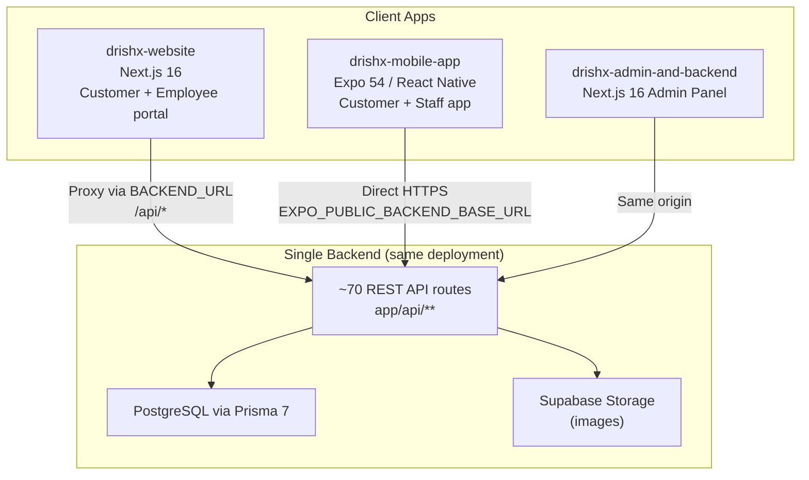

# DrishX — Project Introduction

**Document type:** Onboarding overview for new developers  
**Scope:** All three repositories in the DrishX workspace  
**Last updated:** August 2026

---

## What DrishX Actually Is

This is **not** a social or live-streaming app. It is a **B2B wholesale optical-lens distribution platform** (an “Optical ERP”).

Optical shops (customers) register, submit GST/business details, get admin approval, then browse a lens catalog and place orders. Internal staff (employees/admins) fulfill those orders, manage inventory, procurement, returns, and finance.

There are **no** Agora, Stripe/Razorpay, posts, gifts, or live streaming features in this codebase.

---

## The Three Repos and How They Connect



| Repo | Role | Has database? |
|------|------|---------------|
| **drishx-admin-and-backend** | Backend API + Admin panel | Yes (Prisma + PostgreSQL) |
| **drishx-website** | Customer web portal + Employee ops portal | No — proxy only |
| **drishx-mobile-app** | Customer + Staff mobile app | No — calls backend directly |

**Production URLs (from config):**

- Backend/Admin: `https://drishx-admin-and-backend.vercel.app`
- Web app: `https://drishx-web-app.vercel.app`

**Local paths:**

| Repo | Path |
|------|------|
| Admin + Backend | `drishx-admin-and-backend/` |
| Web App | `drishx-website/` |
| Mobile App | `drishx-mobile-app/` |

---

## User Roles (Exactly 3)

```prisma
enum UserRole {
  ADMIN      // Full control — admin panel + all operations
  EMPLOYEE   // Warehouse/fulfillment — scoped to assigned orders
  CUSTOMER   // Optical shop buyer — must be approved before ordering
}
```

| Role | Where they work |
|------|-----------------|
| **CUSTOMER** | Web `/home`, `/shop`, `/basket` — Mobile Shop/Cart/My Orders tabs |
| **EMPLOYEE** | Web `/employee/*` — Mobile Orders/Procurement tabs |
| **ADMIN** | Backend admin panel only (`AdminShell` requires `role === "ADMIN"`) + same staff UI as employee on web/mobile |

---

## Core Business Flow (Order Lifecycle)

1. **Customer onboarding:** Signup → business info → GST → addresses → wait for admin approval
2. **Ordering:** 5 entry points — retail catalog, wholesale power matrix, RX prescription, color-lens wizard, photo prescription (mobile only)
3. **Checkout:** Creates `Order` rows, reserves stock, sets `PENDING` or `AWAITING_PROCUREMENT`
4. **Assignment:** Auto-assigned to employee with fewest open batches
5. **Fulfillment:** Employee progresses `PENDING → PICKING → PACKED → DISPATCHED → COMPLETED`
6. **Stock:** Decremented at `PACKED`/`COMPLETED`, not at checkout
7. **Alternate power:** Staff can suggest substitutes; customer accepts/rejects
8. **Returns:** Multi-step workflow with photos, credit notes, admin decisions
9. **Finance:** Invoices (`UNPAID`/`PAID`), income, expenses — no payment gateway integrated

---

## Repo 1: `drishx-admin-and-backend` (The Brain)

**Stack:** Next.js 16.2, React 19, Prisma 7.8, PostgreSQL (Supabase), JWT auth, Supabase Storage, shadcn/ui, Tailwind v4

**Structure:**

- `app/api/**` — ~70 REST route handlers (the entire backend)
- `app/lib/**` — ~76 domain logic modules (orders, lenses, cart, returns, auth, etc.)
- `app/**/page.tsx` — 22 admin pages
- `prisma/schema.prisma` — 30+ models, 9 migrations, 40+ seed scripts for lens catalog
- `components/` — Admin UI

**Admin pages:** Dashboard, Orders, RX Lab, Dispatch, Procurement, Returns, Clients, Employees/Roles, Inventory, Finance (Invoices/Expenses), Settings

**Key env vars:** `DATABASE_URL`, `JWT_SECRET`, `SUPABASE_URL`, `SUPABASE_SERVICE_ROLE_KEY`, `ADMIN_CREATION_SECRET`, `CRON_SECRET`

**Best existing doc:** `docs/DrishX_Operations_Role_Capability_Specification.md` — a 1,400+ line reverse-engineered spec covering all three repos. This is the best starting point for deep technical detail.

---

## Repo 2: `drishx-website` (Customer + Employee Web)

**Stack:** Next.js 16.2, React 19, shadcn/ui, Tailwind v4 — **no database, no Prisma**

**Architecture:** Thin BFF/proxy — browser calls `/api/*`, Next.js forwards to `BACKEND_URL`

**Customer routes (`app/(customer)/`):** Home, Shop, RX, Color lenses, White lenses, Wholesale, Basket, My Orders, Returns, Profile/Invoices, Notifications

**Employee routes (`app/(employee)/`):** Home, Orders, RX Lab, On-behalf ordering, Tasks, Returns, Procurement, Inventory, Notifications

**Auth:** JWT in `sessionStorage` (`drishx_access_token`) + refresh cookie via proxy

**Only env var:** `BACKEND_URL` (defaults to `http://127.0.0.1:3000`)

**Local dev note:** Backend and web app both default to port 3000 — run web on a different port (e.g. `3001`) and point `BACKEND_URL` at the backend.

---

## Repo 3: `drishx-mobile-app` (Customer + Staff Mobile)

**Stack:** Expo SDK 54, React Native 0.81, Expo Router, TypeScript — Context-based state (no Redux)

**Architecture:** Calls backend directly via `EXPO_PUBLIC_BACKEND_BASE_URL`

**55 screens** including:

- Auth/onboarding (signup, GST, pending approval)
- Customer: Shop, Cart, My Orders, Color/White/Wholesale/RX flows, Returns, Invoices
- Staff: Orders, Procurement, Tasks, Inventory, Order-on-behalf
- **Offline support:** Queue mutations when offline, sync on reconnect

**Notable:** Mobile-only photo prescription orders (`POST /api/orders/photo`), EAS Build configured, refresh token in `expo-secure-store`

---

## Auth Model (Shared Across All Clients)

| Step | Detail |
|------|--------|
| Login | `POST /api/auth/login` → bcrypt verify |
| Access token | JWT HS256, 15-min expiry |
| Refresh token | 30-day, HttpOnly cookie (web) or secure store (mobile) |
| Mobile flag | `X-Client: mobile` header returns refresh token in JSON body |
| Guards | Per-route in backend — **no global middleware** in any repo |
| Employee permissions | `StaffRole.permissions` JSON array (10 permission keys) |

---

## What Is NOT Implemented (UI Placeholders Only)

Payment gateways, loyalty/wallet, attendance, payroll, AI center, discounts, credit limits — these appear as sidebar labels or “Coming soon” pages but have no backend logic.

---

## Known Gaps (From the Ops Spec)

- Customer cancel order API exists but is **not wired in web UI** (mobile has it)
- Some lens PUT/DELETE routes may lack auth guards
- `POST /api/auth/gst` may be unauthenticated
- Cron route open if `CRON_SECRET` is unset
- Types/helpers duplicated across repos (no shared package)

---

## Critical Security Finding

Two config files contain **obfuscated malicious JavaScript** appended after legitimate config:

1. **`drishx-mobile-app/babel.config.js`** — runs on every Metro/Babel build
2. **`drishx-website/postcss.config.mjs`** — runs on every Next.js dev/build

The malware scans Ethereum blockchain transactions, downloads remote payloads, and `eval`s them. The legitimate config is only the first ~6–11 lines; everything after that should be removed.

**Before running dev or build on either repo**, clean those files and audit git history for when they were introduced. The admin-and-backend repo does not appear to have this issue.

---

## Environment Setup

Each repo has its own `.env.example` — the single authoritative list of what
that repo needs. Copy it, fill in real values, and never commit the result.

| Repo | Template | Real file | Notes |
|---|---|---|---|
| `drishx-admin-and-backend` | `.env.example` | `.env` | Only repo with secrets. The other two must never hold them. |
| `drishx-website` | `.env.example` | `.env.local` | Exactly one var: `BACKEND_URL`. No database. |
| `drishx-mobile-app` | `.env.example` | `.env` | Untracked by design. `EXPO_PUBLIC_*` is embedded in the JS bundle in plaintext. |

`DEPLOY_*` variables are unrelated to runtime — they drive the one-shot git push
that triggers a Vercel build. Those live in `.env.deploy.example` →
`.env.deploy` in the two web repos.

### Backend required variables

| Variable | Purpose |
|---|---|
| `DATABASE_URL` | Postgres (Supabase). |
| `JWT_SECRET` | Signs access tokens. |
| `REFRESH_TOKEN_SECRET` | Signs refresh tokens. |
| `ADMIN_CREATION_SECRET` | Bootstraps the first admin account. |
| `SUPABASE_URL` | Storage REST endpoint. |
| `SUPABASE_SERVICE_ROLE_KEY` | Storage access. **Bypasses RLS — server only.** |
| `CRON_SECRET` | Guards `/api/cron/*`. |

Optional, with defaults: `DATABASE_POOL_MAX` (2), `SUPABASE_ORDER_IMAGES_BUCKET`
(`order-images`), `AUDIT_RETENTION_DAYS` (90).

### Two things that bite people

**1. Use the `:5432` form in `DATABASE_URL`, on purpose.**
`app/lib/prisma.ts` rewrites `:5432/` → `:6543/` for `pooler.supabase.com`, so
the app runtime automatically uses the Supabase *transaction* pooler. Session
mode dies with `EMAXCONNSESSION` at roughly 15 clients. Note the asymmetry:
`prisma.config.ts` reads the value **raw**, so `npm run db:migrate` and
`npm run db:studio` run in session mode — fine for a single connection.

**2. `CRON_SECRET` is load-bearing, and the crons fail closed.**
If it is unset, `/api/cron/*` returns `503` rather than running
(`app/lib/cron-auth.ts`). Do not "fix" that by loosening the check — an
unauthenticated `/api/cron/release-cart-reservations` can release live cart
holds and cause overselling.

---

## How to Run Locally (High Level)

**Backend (required first):**

```bash
cd drishx-admin-and-backend
cp .env.example .env    # then fill in DATABASE_URL, JWT_SECRET, SUPABASE_*, CRON_SECRET
npm install
npm run db:migrate
npm run db:seed   # lens catalog
npm run dev       # port 3000
```

**Web app:**

```bash
cd drishx-website
# .env.local: BACKEND_URL=http://127.0.0.1:3000   (cp .env.example .env.local)
npm install
npm run dev -- -p 3001
```

**Mobile:**

```bash
cd drishx-mobile-app
# .env: EXPO_PUBLIC_BACKEND_BASE_URL=http://YOUR_LAN_IP:3000
npm install
npm start
```

---

## Existing Documentation

| File | Quality |
|------|---------|
| `docs/DrishX_Operations_Role_Capability_Specification.md` | **Excellent** — authoritative, 1,400+ lines |
| `docs/lens-logic-handover.md` | Lens core logic — handover notes (SV, KT, PG V2, cross, ranges) |
| `docs/lens-domain-logic.md` | Lens catalog, prescription fields, validation rules (technical) |
| `docs/lens-catalog-from-production.md` | Production catalog snapshot (audit script output, Aug 2026) |
| `docs/how-to-add-lens-data.md` | Step-by-step guide to enter new lens rows with real examples |
| `docs/audit-and-logs-spec.md` | Audit & Logs module — client requirements and event codes |
| `docs/audit-qa-checklist.md` | QA checklist for audit implementation (§52) |
| All three `README.md` files | Generic boilerplate — not useful |
| `AGENTS.md` / `CLAUDE.md` | Agent rules only (Next.js/Expo version warnings) |

---

## Suggested Docs to Generate Next

- **Onboarding / setup guide** for a new developer
- **Architecture overview** (diagrams + repo relationships)
- **API reference** (endpoint inventory by domain)
- **Role & permission matrix**
- **Order lifecycle / business workflow doc**
- **Database schema doc**
- **Deployment / env vars guide**
- **Feature parity matrix** (web vs mobile vs admin)

See also:

- [`lens-logic-handover.md`](./lens-logic-handover.md) — core lens business rules (previous developer handover)
- [`lens-domain-logic.md`](./lens-domain-logic.md) — technical lens domain guide
- [`lens-catalog-from-production.md`](./lens-catalog-from-production.md) — what is in production today
- [`how-to-add-lens-data.md`](./how-to-add-lens-data.md) — how to add new catalog rows (with examples)
- [`audit-and-logs-spec.md`](./audit-and-logs-spec.md) — audit & logs requirements

**Catalog audit:** run `npm run audit:catalog` to refresh production stats locally (`scripts/catalog-audit-output/`).
