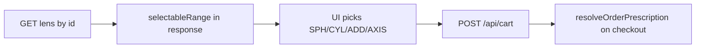

# DrishX — Lens Domain Logic

**Document type:** Developer guide to optical/lens business rules as implemented in code  
**Audience:** Engineers who know the codebase but not the lens industry  
**Scope:** Catalog structure, prescription fields, validation rules, and power-selection logic  
**Last updated:** August 2026

---

## 1. Purpose

This document explains **how lenses work in DrishX** — not order fulfillment, stock, or user roles. It covers:

- What SPH, CYL, AXIS, ADD, and related fields mean in this system
- How Single Vision, Kryptok, and Progressive differ in the database and API
- How catalog rows become selectable powers in the shop
- Where validation happens (retail, wholesale, RX, color, returns)

For platform overview, see [`intro.md`](./intro.md). For business rules explained as handover notes (SV/KT/PG V2, chained ranges, cross), see [`lens-logic-handover.md`](./lens-logic-handover.md). For full role/API inventory, see [`DrishX_Operations_Role_Capability_Specification.md`](./DrishX_Operations_Role_Capability_Specification.md).

---

## 2. Optics glossary (minimal)

| Term | Optical meaning | In DrishX |
|------|-----------------|-----------|
| **SPH (Sphere)** | Main lens power: minus = myopia, plus = hyperopia | Decimal diopters; steps of **0.25** |
| **CYL (Cylinder)** | Astigmatism correction | Usually negative in catalog; optional on many SKUs |
| **AXIS** | Orientation of cylinder (1–180°) | Required for RX/color orders; stored on Kryptok/Progressive catalog rows |
| **ADD** | Extra power for reading (near zone) | Required on **Kryptok** and **Progressive** catalog rows |
| **Index** | Material refractive index (1.56, 1.67, …) | Product attribute — thinner lens at same power |
| **Coating** | Surface treatment / colour family | HC, HMC, Blue Cut, Green, Violet, etc. — used for filtering and product identity |
| **Category / Brand / Item** | Wholesale price-sheet hierarchy | Industry product-line labels — not prescription math |

**Diopter step:** All generated power lists use **0.25D** steps (`POWER_STEP` in `app/lib/lens-power-range.ts`).

---

## 3. Lens types in the database

There are **six** Prisma enum values, each with its own table:

```prisma
enum LensType {
  SINGLE_VISION
  KRYPTOK
  PROGRESSIVE
  ORI_VISION
  MAGNUS
  BIFOCAL
}
```

The **main shop and wholesale flows** focus on the first three:

| Type | Optical use (simplified) | Primary table |
|------|--------------------------|---------------|
| **Single Vision** | One focal power across the lens | `SingleVisionLens` |
| **Kryptok** | Bifocal-style (segment / near ADD) | `KryptokLens` |
| **Progressive** | No-line multifocal | `ProgressiveLens` |

`ORI_VISION`, `MAGNUS`, and `BIFOCAL` exist in schema and seeds but are secondary in customer shop APIs.

Every `Order` links to **exactly one** lens row via a polymorphic FK based on `lensType`.

---

## 4. Core mental model: catalog rows are not just “products”

A row in the lens catalog is usually one of:

### 4.1 Fixed-power SKU

One exact SPH (and optionally CYL), e.g. SPH −2.00, CYL −0.50.

### 4.2 Range SKU (price-sheet row)

The row defines a **selectable range**, not a single power:

| DB field | Meaning |
|----------|---------|
| `sph` | **End** of SPH range (“to” bound) |
| `sphStartRange` | **Start** of SPH range (optional; defaults toward 0) |
| `cyl` | **End** of CYL range |
| `cylStartRange` | **Start** of CYL range |

**Example:** `sphStartRange = 0`, `sph = -6.00` → customer can pick 0, −0.25, −0.50, …, −6.00.

The backend generates all values in 0.25 steps via `generatePowerOptions()` in `app/lib/lens-power-range.ts`.

### 4.3 Cross-cylinder SKU

Special astigmatism pattern using `crossPower` instead of normal SPH/CYL ranges. See [Section 7](#7-cross-cylinder-products).

### 4.4 Product identity and “siblings”

Multiple catalog rows with different powers but the same product identity are **siblings**. The backend groups them to compute **`selectableRange`** — the SPH/CYL lists shown in the UI.

| Lens type | Siblings share |
|-----------|----------------|
| Single Vision | `category` + `brand` + `item` + `index` + `coating` |
| Kryptok | `category` + `brand` + `coating` |
| Progressive | `category` + `brand` + `item` + `index` + `type` + `coating` |

Sibling lookup: `app/lib/related-lenses.ts` (`findSingleVisionSiblings`, `findKryptokSiblings`, `findProgressiveSiblings`).

Range computation: `computeSelectableRange()` in `app/lib/lens-power-range.ts`, exposed on lens detail APIs as `selectableRange`.

---

## 5. Power shapes (SPH-only / CYL-only / compound)

The shop classifies catalog rows into **power shapes** (`app/lib/lens-power-shape-filter.ts`):

| Shape | Meaning | DB pattern |
|-------|---------|------------|
| **sph** | Sphere only | Non-zero SPH, no CYL |
| **cyl** | Cylinder only | Non-zero CYL, no SPH |
| **compound** | Both | Non-zero SPH **and** CYL |

When all coatings in a subcategory are generic hardcoats (HC, HMC, SHMC, UC), the UI falls back to these power-shape filters instead of colour/coating chips.

**Schema note:** Kryptok and Progressive require `sph` (non-nullable). Single Vision allows nullable `sph`.

---

## 6. Single Vision

### 6.1 Schema fields

From `SingleVisionLens` in `prisma/schema.prisma`:

| Field group | Fields |
|-------------|--------|
| Product | `category`, `brand`, `item`, `index`, `coating` |
| Power | `sph`, `sphStartRange`, `cyl`, `cylStartRange`, `crossPower` |
| Commercial | `costPrice`, `price`, `quantity` |

**Not present:** `axis`, `add`, `eye`.

### 6.2 Rules in code

1. **Selectable range** — powers must fall inside `selectableRange` returned by the API (UI contract).
2. **Compound no-plano** — if the catalog row has both meaningful SPH and CYL, **0.00 (plano) is disallowed** on either axis (`applyCompoundNoPlano` in `lens-power-range.ts`).
3. **Wholesale compound grid** — allowed SPH/CYL sign combos (`isAllowedCompoundCombo` in `wholesale-powers.ts`):
   - Allowed: both +, both −, SPH+ with CYL−
   - **Not allowed:** SPH− with CYL+
4. **Cross products** — separate rules; see [Section 7](#7-cross-cylinder-products).
5. **Catalog search** — exact match, in-range match, or nearest within **0.5D** combined distance (`|Δsph| + |Δcyl|`) — `app/lib/catalog-power-search.ts`.
6. **ADD** — not supported (`supportsAdd: false` in returns validation).

---

## 7. Cross-cylinder products

Used in Single Vision and Kryptok wholesale lines (item often labeled **"CROSS"**).

### 7.1 Optical pattern (simplified)

Unusual Rx: **SPH is positive**, **CYL is negative**, and **|CYL| ≥ SPH + 0.25**.

### 7.2 Identification

A row is a cross product if:

- It has explicit `crossPower`, **or**
- Legacy row matches the cross prescription pattern (`hasCrossPower()` in `app/lib/cross-product.ts`).

### 7.3 Selection rules

| Axis | Rule |
|------|------|
| **SPH** | Always **positive**, from +0.25 up to `|CYL| − 0.25` |
| **CYL** | Always **negative**, from `cylStartRange` (or −0.25) down to `crossPower` |
| **Minimum gap** | `|CYL| − SPH ≥ 0.25` (`CROSS_MIN_GAP`) |

**Example:** CYL −2.00 → SPH options: +0.25, +0.50, …, +1.75.

Validation: `isAllowedCrossCombo()` in `app/lib/cross-power.ts` and `app/lib/cross-product.ts`.

Wholesale: profile `"cross"` → grid mode `"compound"` with cross combo filtering (`wholesale-powers.ts`, `wholesale-matrix.ts`).

---

## 8. Kryptok

### 8.1 What it is in this app

Bifocal-style wholesale lenses. “Kryptok” is a **product line name** in Indian optical wholesale — not a generic programming term.

### 8.2 Extra fields vs Single Vision

| Field | Industry meaning | In code |
|-------|------------------|---------|
| **axis** | Cylinder orientation variant the stock row is cut for | `90` = ST.AXIS, `180` = REV AXIS, `45`/`135` = SPL AXIS |
| **add** | Reading segment power | Required on every row; typical values PLANO or +4.00 |
| **item** | Wholesale line label | e.g. `"CROSS"`; resolved via `kryptok-wholesale-catalog.ts` |

### 8.3 Rules

- Same SPH/CYL range, compound, and cross logic as Single Vision (`computeKryptokSelectableRange` + compound no-plano).
- **`add` is part of SKU identity** — same SPH/CYL with different ADD = different product.
- **`axis` is part of SKU identity** for stock dedupe and order resolution (`resolve-lens-stock.ts`).
- **ADD supported** in returns/replacement validation (`supportsAdd: true`).

Product key for range grouping: `category | brand | coating` (`kryptokProductKey()`).

---

## 9. Progressive

### 9.1 Extra fields vs Kryptok

| Field | Meaning |
|-------|---------|
| **index** | Material index (1.56, 1.61, …) |
| **type** | Lens grade: HC, HMC, SHMC |
| **coating** | Colour / treatment label |
| **eye** | **LEFT or RIGHT** — each catalog row is per-eye |
| **add** | Progressive near-zone addition (required) |
| **axis** | Often auto-computed from SPH/CYL signs |

### 9.2 Auto axis rule

From wholesale price-sheet convention (`app/lib/progressive-axis.ts`):

| Condition | Axis |
|-----------|------|
| CYL only, +CYL | 180° |
| CYL only, −CYL | 90° |
| Compound, both + | 180° |
| Compound, both − | 90° |
| Mixed | −CYL → 90°, +CYL → 180° |

If `axis` is already set on the row, it is not overwritten.

### 9.3 Rules

- Same compound no-plano as Kryptok.
- Product key: `category | brand | item | index | type | coating` (`progressiveProductKey()`).
- Stock dedupe includes **eye** — OD/OS can be separate SKUs.
- **ADD supported** in replacement validation.

---

## 10. Side-by-side comparison

| | Single Vision | Kryptok | Progressive |
|--|---------------|---------|-------------|
| **Optical use** | Single focal power | Bifocal (segment) | No-line multifocal |
| **ADD on SKU** | No | Required | Required |
| **AXIS on SKU** | No | Yes (90/180/45/135) | Yes (often auto-derived) |
| **EYE (L/R)** | No | No | **Yes — per row** |
| **Index + type** | Index only | No index | Index + type (HC/HMC/SHMC) |
| **Cross products** | Yes | Yes (CROSS item) | No dedicated cross wholesale profile |
| **Compound no-plano** | If compound row | Yes | Yes |
| **Wholesale profiles** | sph-only / cyl-only / compound / cross | Same | Same |

---

## 11. Where validation happens (by flow)

### 11.1 Retail shop (catalog → power → cart)



1. API returns `selectableRange` per lens (`GET /api/lenses/{type}/{id}`).
2. UI should only offer powers in `selectableRange.sph.options` / `cyl.options`.
3. Cart stores chosen `sph`, `cyl`, `axis`, `add`, `eye` on `CartReservation`.
4. On order placement, `resolveOrderPrescription()` merges cart → request body → catalog defaults (`app/lib/order-prescription.ts`).

**Note:** Simple cart POST does not always re-validate power ∈ range server-side. Returns/replacement **do** validate against catalog range.

### 11.2 Wholesale (power matrix)

1. User defines SPH/CYL ranges + step, or uses compound/cross grid.
2. `wholesale-powers.ts` and `wholesale-matrix.ts` filter illegal combos.
3. Each matrix cell = one power combination → cart line with quantity.
4. Checkout via `POST /api/orders/wholesale-checkout`.

Wholesale power profiles (`resolveWholesalePowerProfile`):

| Profile | Grid modes available |
|---------|---------------------|
| `sph-only` | sph-only |
| `cyl-only` | cyl-only |
| `compound` | sph-only, cyl-only, compound |
| `cross` | compound (with cross combo rules) |

### 11.3 RX orders (`POST /api/orders/rx`)

- **Free-form prescription** — not tied to a catalog SKU row.
- `parseEyePower()`: SPH, CYL, AXIS must be finite; ADD optional (`app/lib/rx-order.ts`).
- Progressive/Kryptok lens types include ADD in formatted notes.
- **Diameter** (mm) included for lab instructions.
- Stored in `Order.notes` + optional `orderImageUrl`.

### 11.4 Color lens orders (`POST /api/orders/color-lens`)

- Same free-form prescription parsing (`app/lib/color-lens-order.ts`).
- Fixed **70 mm diameter** (`COLOR_LENS_DIAMETER_MM`).
- Color, tint strength, material, index, coating → order notes.
- Not matched against catalog stock rows.

### 11.5 Returns — replacement power

- `getSelectableRangeForOrder()` reloads sibling catalog and rebuilds allowed SPH/CYL lists (`app/lib/returns.ts`).
- Requested replacement power must fall in that range for catalog-backed orders.
- RX/color/custom orders may have no catalog range (validation skipped).

### 11.6 Alternate power suggestions

- Staff suggests nearby catalog powers within configured SPH/CYL deltas.
- Uses sibling products + stock availability scoring (`app/lib/alternate-power-suggestions.ts`).

---

## 12. Catalog search and nearest-power matching

When a user searches e.g. `−2.25 / −0.50`:

| Match mode | Condition |
|------------|-----------|
| **exact** | Row endpoint matches exactly |
| **range** | Target falls inside `sphStartRange…sph` and `cylStartRange…cyl` |
| **nearest** | Within **0.5D** total distance: `|Δsph| + |Δcyl|` |

Implementation: `scoreCatalogPowerMatch()`, `powerInSelectableRange()` in `app/lib/catalog-power-search.ts`.

Used in shop search, related lenses, and alternate suggestions.

---

## 13. Flows that bypass catalog SKU logic

| Flow | Behavior |
|------|----------|
| **White lens catalog** | Client-side static list (`lib/white-catalog.ts` in web/mobile) — no backend lens table |
| **RX / color / photo orders** | Lab instructions in notes; minimal catalog validation |
| **OriVision / Magnus / Bifocal** | DB tables exist; not in main unified shop API focus |

---

## 14. Key source files

| Topic | Path |
|-------|------|
| Schema | `prisma/schema.prisma` |
| Range generation | `app/lib/lens-power-range.ts` |
| Cross-cylinder math | `app/lib/cross-product.ts`, `app/lib/cross-power.ts` |
| Power shape filters | `app/lib/lens-power-shape-filter.ts` |
| Search / nearest match | `app/lib/catalog-power-search.ts` |
| Power distance | `app/lib/power-distance.ts` |
| Wholesale combo rules | `app/lib/wholesale-powers.ts`, `app/lib/wholesale-matrix.ts` |
| Progressive axis | `app/lib/progressive-axis.ts` |
| Product siblings | `app/lib/related-lenses.ts` |
| Stock / dedupe | `app/lib/resolve-lens-stock.ts` |
| Unified lens API | `app/api/lenses/route.ts` |
| Lens detail APIs | `app/api/lenses/single-vision/[id]`, `kryptok/[id]`, `progressive/[id]` |
| RX parsing | `app/lib/rx-order.ts` |
| Color lens parsing | `app/lib/color-lens-order.ts` |
| Order prescription merge | `app/lib/order-prescription.ts` |
| Replacement validation | `app/lib/returns.ts` |
| Alternate suggestions | `app/lib/alternate-power-suggestions.ts` |
| Kryptok API mapping | `app/lib/kryptok-lens-map.ts` |
| Wholesale catalog matchers | `app/lib/single-vision-wholesale-catalog.ts`, `kryptok-wholesale-catalog.ts`, `progressive-wholesale-catalog.ts` |

---

## 15. Worked examples

### 15.1 Range SKU — Single Vision

**Catalog row:**

- `sphStartRange = 0`, `sph = -4.00`
- `cyl = -2.00`, `cylStartRange = 0`

**Selectable range (conceptually):**

- SPH: 0, −0.25, −0.50, …, −4.00
- CYL: 0, −0.25, …, −2.00

If this is a **compound row** (both axes meaningful), plano (0.00) is stripped from both lists.

### 15.2 Compound sign rule — wholesale

| SPH | CYL | Allowed? |
|-----|-----|----------|
| +2.00 | +1.00 | Yes |
| −2.00 | −1.00 | Yes |
| +2.00 | −1.00 | Yes |
| −2.00 | +1.00 | **No** |

### 15.3 Cross product

**Catalog:** `crossPower = -2.00`

- CYL options: −0.25, −0.50, …, −2.00
- If user picks CYL −2.00 → SPH options: +0.25 … +1.75

### 15.4 Progressive axis auto-fill

| SPH | CYL | Resolved axis |
|-----|-----|---------------|
| (empty) | +1.50 | 180 |
| (empty) | −1.50 | 90 |
| +2.00 | +1.00 | 180 |
| −2.00 | −1.00 | 90 |

---

## 16. Summary

DrishX models a **wholesale optical price sheet**:

1. Each DB row = product line + power endpoint or range (plus type-specific fields like ADD, AXIS, EYE).
2. The backend converts rows into **`selectableRange`** for the shop UI.
3. **Industry combo rules** (compound signs, cross-cylinder math, Kryptok axis variants, progressive per-eye rows) live in `app/lib/`.
4. **RX and color orders** skip SKU matching and send free-form prescriptions to the lab via order notes.

---

## Related docs

- [`intro.md`](./intro.md) — three-repo overview
- [`lens-logic-handover.md`](./lens-logic-handover.md) — core lens business rules (handover notes)
- [`DrishX_Operations_Role_Capability_Specification.md`](./DrishX_Operations_Role_Capability_Specification.md) — full ops spec

**Suggested follow-ups:**

- Lens field reference with seed-data examples
- Power validation decision tree (retail vs wholesale vs RX)
- Wholesale matrix builder deep dive
